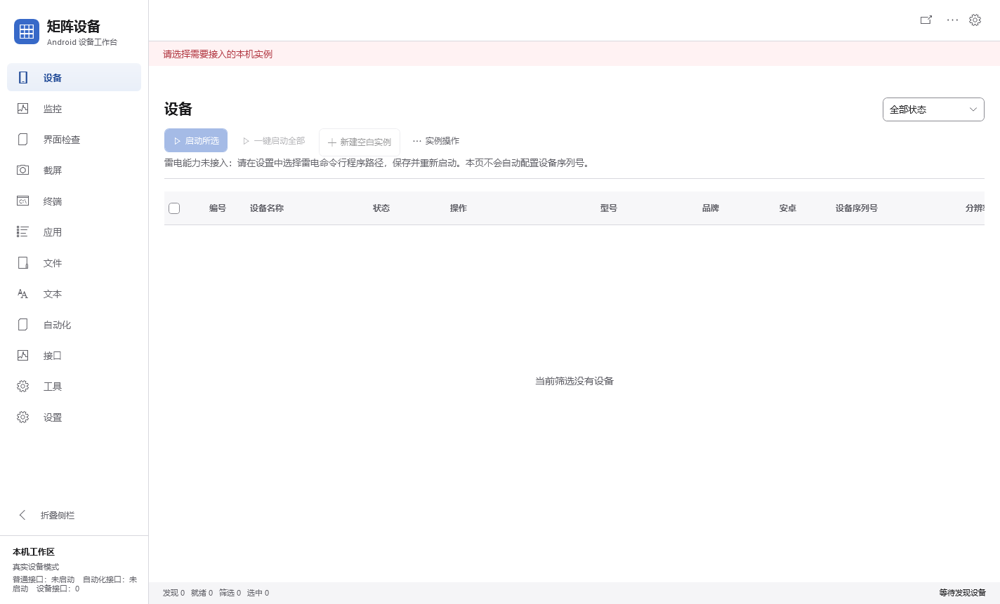
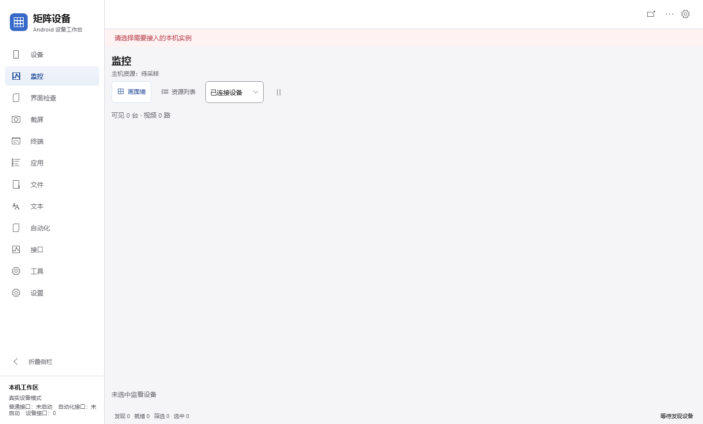
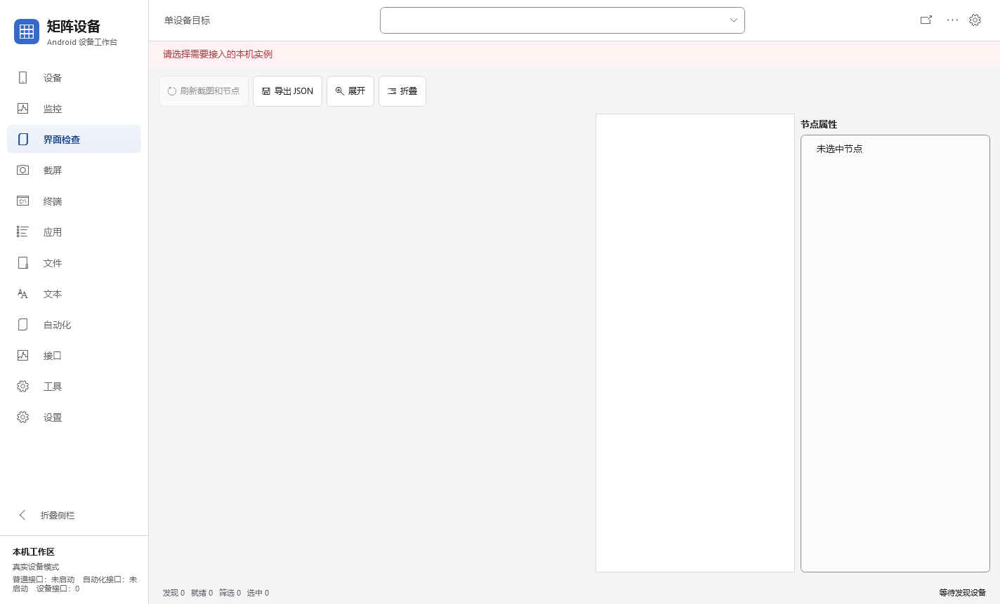
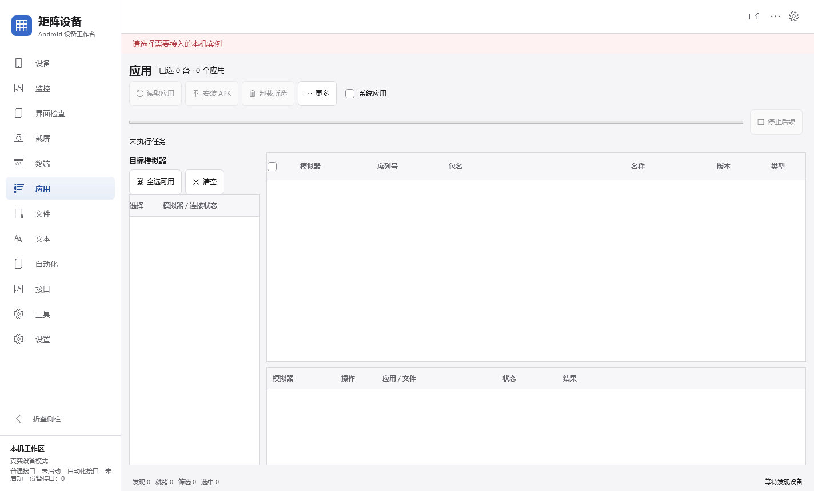
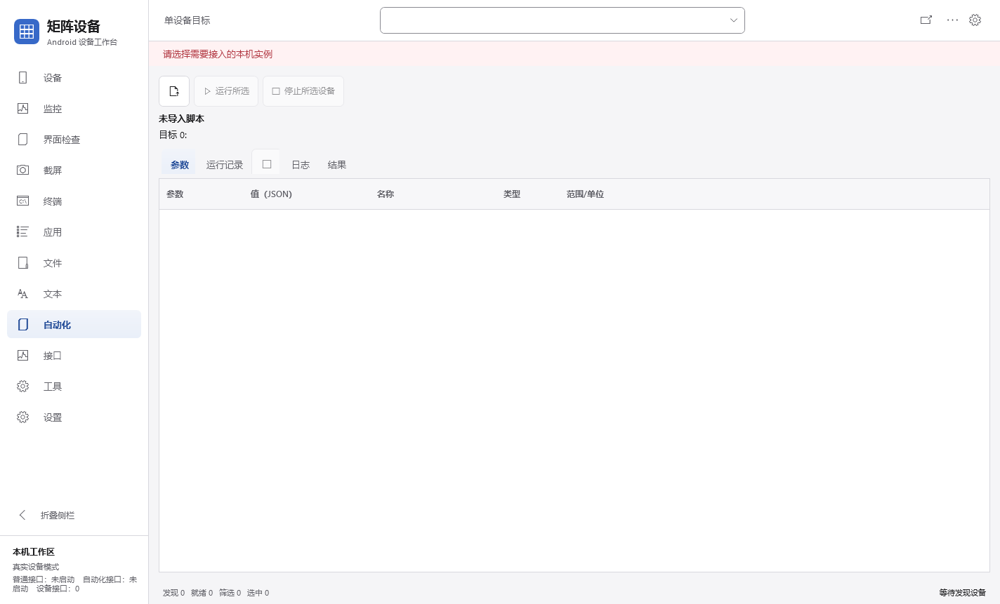
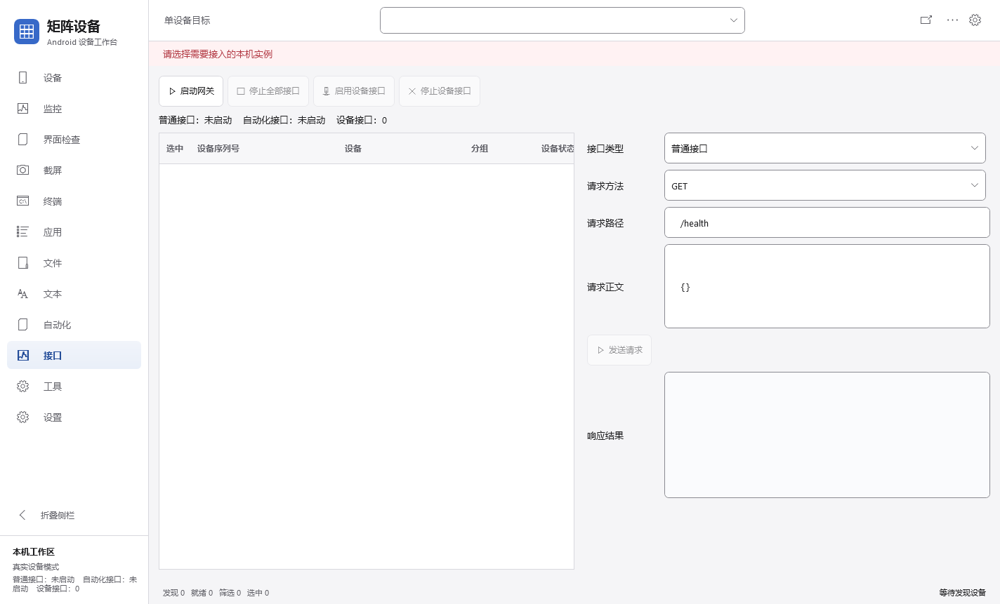
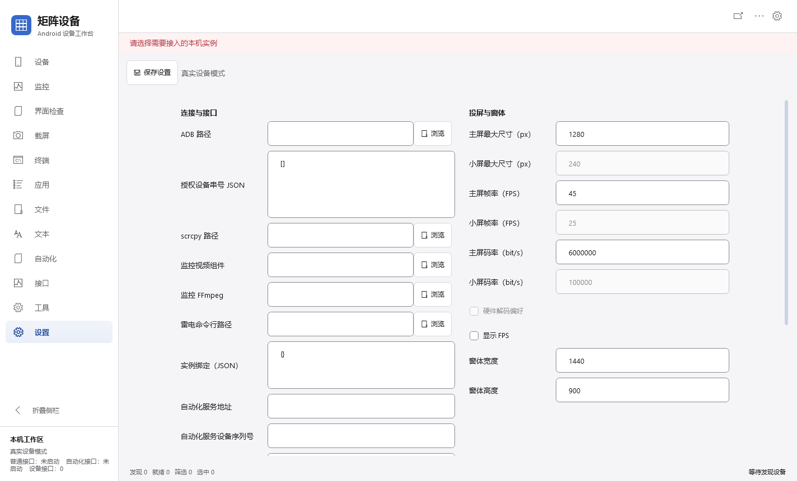

# 矩阵设备

面向 Windows 的 Android / 雷电模拟器管理与调试工作台，采用 C#、.NET 10 和 WPF，默认使用简体中文。将实例接入、画面监看、界面节点、应用、文件和自动化操作集中到一个桌面程序中。

本仓库用于**正式版本的源码发布**，默认分支为 `main`；`test` 保留历史备份，`codex/unified-device-access` 保留开发历史。工程依据参考文档独立编写，**不是雷电官方产品，也不是原商业软件的源码或完整替代品**。发布范围和已知限制见下文，不以正式发布名义将未验收项目标为通过。

[功能介绍](#功能介绍) · [界面介绍](#界面介绍) · [快速开始](#快速开始) · [真实设备接入](#真实设备接入) · [验证与限制](#验证与限制)

## 功能介绍

| 页面 | 主要功能 | 交互与边界 |
| --- | --- | --- |
| **设备** | 统一列出本地雷电实例与设备，查看状态、型号、品牌、Android 版本、序列号、分辨率；单台、所选或全部启动接入 | 固定列表、自动更新；关闭实例先启动，运行实例只连接；新建空白实例不自动开机 |
| **监控** | 卡片内直接观看已连接设备的视频；资源列表展示主机和实例 CPU、内存、短期趋势 | 无需放大卡片；需要视频组件；暂停、切页和移出可见区域释放对应视频会话，不关闭模拟器 |
| **界面检查** | 读取截图和 UI 节点树，查看属性与边界，导出 JSON，辅助元素定位 | 截图与节点绑定设备身份，拒绝迟到结果覆盖；动态页面可能无法生成节点 |
| **截屏** | 读取屏幕、缩放、取色、裁剪、导出 PNG | 定位截图与实时视频分开，视频帧不会覆盖正在检查的坐标 |
| **终端** | 对指定设备执行 Android Shell，查看输出、命令历史 | 结果保留设备归属；执行期间可准备新草稿；不是电脑端通用 Shell |
| **应用** | 按模拟器读取安装列表，多选 APK 安装，勾选应用卸载；更多菜单提供启动、停止、清数据 | 独立选择目标、操作确认、逐项进度和错误；系统应用有保护，卸载和清数据不可撤销 |
| **文件** | 上传、下载、传输队列、停止、重试，可选择上传 APK 后安装 | 每项任务保留设备与路径；停止不撤销已完成操作 |
| **文本** | 编辑、粘贴、载入文件，向单台或所选设备发送文字 | 加载期间保留新草稿；雷电中文输入需要明确有效的实例绑定 |
| **自动化** | 导入 `.jxscript` / `.zip`，设置参数，查看逐设备任务、日志和结果，按任务取消 | 支持已定义的应用启动、等待、点击、滑动及参数绑定；不执行任意 Python / JavaScript，不是通用 RPA |
| **接口** | 普通 HTTP、Automator、逐设备接口启停，页面内请求与响应调试 | 默认不自动启动；受控本机集成，没有生产级鉴权，不应暴露到公网 |
| **工具** | 解析代理配置、导出无凭据 JSON、核验 root，确认后应用并核验时区 | 时区操作需要 root；代理运行器和私有 ROM 路由规则未恢复，不提供代理连接 |
| **设置** | 雷电命令行、设备授权与绑定、视频组件、接口端口、窗口参数 | 连接路径变更通常需重启；未实现的硬件解码等参数保持禁用 |

### 实例与群控

- **一个设备入口**：关闭、启动中、待连接和已连接实例同屏管理，不再拆成“全部设备 / 高级管理”，没有搜索、分组筛选或设备卡片模式。
- **一键启动**：行内启动、启动所选、一键启动全部共享接入流程，显示进度，可停止后续。仅检测到明确内存不足时确认；资源未知不等于不足，也不保证启动成功。
- **实例操作**：新建空白实例；对唯一勾选实例配置 CPU、内存、分辨率、DPI，或关闭、重启。配置要求完全退出；编号 `0` 正常可用，负数和内部哨兵拒绝。
- **主控与同步**：“控制”打开嵌入面板。同步点击滑动只复制该面板手势；同步按键只复制程序内主页、返回、任务、音量键，目标是明确勾选的其他设备。不是物理键盘镜像，也不监听雷电原生窗口。
- **目录一致性**：成功更新雷电目录后移除已删除实例的旧离线展示，清理相关选择；读取失败不当作空目录，不删除内部身份历史或授权配置。
- **窗口行为**：已移除后台隐藏启动，启动按雷电默认方式显示窗口。监控卡片可请求显示经进程身份核验的既有雷电窗口，再用鼠标键盘操作。

## 界面介绍

以下 7 张图片于 **2026-10-22** 从正式构建的独立、未配置真实工作区渲染。没有模拟设备、预置应用、伪造节点或监控画面；未接入设备时如实显示空状态。截图仅介绍页面布局，不代表已连接模拟器或通过物理输入、视频性能验收。来源和摘要见 [截图说明](docs/images/README.md)。

### 设备列表

左侧统一导航，正文集中显示实例状态与操作。勾选用于批量启动或群控，状态筛选只影响显示；横向滚动可查看其余字段。



### 多画面监控

接入真实设备后，画面墙用于观察设备页面，资源列表用于查看资源变化。**图中没有接入设备，所以可见设备与视频均为 0，没有补入假卡片、视频或资源值。**



### 界面检查

左侧截图、中间节点树、右侧属性，用于确认元素和自动化坐标。未接入设备时不生成图像或节点。



### 应用管理

左侧独立勾选目标，右侧保留应用所属设备、序列号、包名和版本，底部逐项反馈结果。安装时选 APK 并确认目标；卸载时勾选应用行并确认数据损失。



<details>
<summary>自动化、接口与设置截图</summary>

**自动化**：导入脚本包后切换参数、运行记录、日志、结果；图中没有预载脚本或任务记录。



**接口**：左侧管理设备接口，右侧编辑请求与查看响应。图中服务未启动，没有实际请求结果。



**设置**：连接、视频组件与窗体参数分区展示。图中没有真实路径、授权串号或账号配置。



</details>

## 快速开始

### 运行环境

- Windows 10 / 11；WPF 程序不能直接在 Linux、macOS 运行。
- [.NET 10 SDK](https://dotnet.microsoft.com/download/dotnet/10.0)，`global.json` 固定 `10.0.402`，允许同系列更新补丁。
- PowerShell 7、Git，以及首次还原 NuGet 依赖所需网络。
- 自行安装雷电；视频组件、APK、便携 SDK 和本机配置不随源码分发。

```powershell
git clone --branch main https://github.com/zhuy3075-ui/matrix-device-ldplayer.git
cd matrix-device-ldplayer
./tools/Build.ps1
./tools/Start-Desktop.ps1
```

正式程序仅展示实际发现、明确接入的设备，不提供演示运行入口或自动补充虚拟设备。首次运行须先配置雷电与目标；没有设备时列表为空。仓库暂未提供发布安装包。

使用自行安装的便携 SDK 时，可显式指定路径（请替换为实际位置）：

```powershell
./tools/Build.ps1 -DotnetPath 'C:\Tools\dotnet\dotnet.exe'
```

## 真实设备接入

1. 正常启动雷电，确认其既有 ADB 服务可用。本程序连接已有服务，不运行外部 `adb.exe`，不主动创建、停止或重启共享 ADB。
2. 运行 `./tools/Start-Desktop.ps1`，在“设置”指定实际雷电命令行文件（`ldconsole.exe` / `dnconsole.exe`），保存后重启。
3. 在“设备”点击行内启动，或勾选后“启动所选”。已运行实例仅连接；关闭实例先开机，再等待连接和截图核验。后台发现不会自动启动或授权全部实例。
4. 接入后按任务进入“控制”“监控”“界面检查”“应用”等页面。不同页面的选择不会暗中互相授权。
5. 新建空白实例只创建并提交配置，**需要再点该行启动**。资源不足、超时、ADB 服务变化或身份不符会如实失败，不按编号推测串号或端口授信。

也可以指定自己的独立配置目录，不要直接复制他人的授权配置：

```powershell
./tools/Start-Desktop.ps1 -DataDirectory 'C:\MatrixWorkspace\my-devices'
```

桌面默认数据目录为 `%LOCALAPPDATA%\MatrixDevice.Reconstructed\data\`，保存本工程配置、SQLite 元数据和日志，不读取旧商业产品账号、数据库或旧演示工作区。

### 视频与资源监控

在“设置”配置以下组件并重启：

| 配置 | 要求 |
| --- | --- |
| 监控视频组件 | 官方 [scrcpy-server v3.3.4](https://github.com/Genymobile/scrcpy/releases/tag/v3.3.4)，SHA-256：`8588238c9a5a00aa542906b6ec7e6d5541d9ffb9b5d0f6e1bc0e365e2303079e`，不能任意替换版本 |
| 监控 FFmpeg | 本机已有 `ffmpeg.exe`；路径留空仅查找 PATH 中已安装程序 |

画面最大边 320 像素，源端上限 10 帧/秒、1 Mbit/s，UI 最多每秒呈现 8 次并丢弃旧帧。静止页面可能不产生新帧，视频到帧率不是游戏 FPS。资源约每 2 秒采样，保留本次会话最多 15 分钟趋势；实例工作集是 Player 与虚拟机进程工作集之和，不是 Android 可用内存。GPU、网络、磁盘和应用 FPS 未接入。

此视频链路不启用音频、控制、剪贴板或亮屏；独立 `scrcpy.exe` 投屏与监控视频是两套链路，见 [工程记录](ENGINEERING_NOTES.md#实时监控)。

## 接口与脚本

| 入口 | 当前能力 |
| --- | --- |
| 普通 HTTP | 默认 `http://localhost:8080/`；`GET /health`、`GET /devices` |
| 逐设备 HTTP | 页面显式启动的 `8001..8999` 端口；设备信息、Shell、点击、滑动、文字、应用启停 |
| Automator | 默认 `http://127.0.0.1:17171/`；路由见 [API 参考](docs/reference/API.md) 和源码 `AutomationService.Routes` |
| MCP stdio | 不随正式产品构建或分发；既有协议回归实现仅留在 `tests/`，真实设备 MCP 尚未提供 |

在已配置且获得设备授权的工作区启用本机接口（示例使用非默认端口）：

```powershell
dotnet ./src/MatrixDevice.Cli/bin/Release/net10.0/MatrixDevice.Cli.dll --data 'C:\MatrixWorkspace\my-devices' --serve --basic-port 18080 --automator-port 17172
```

在另一终端读取实际状态；未配置授权设备时不会返回虚拟设备：

```powershell
Invoke-RestMethod http://localhost:18080/health
Invoke-RestMethod http://localhost:18080/devices
```

`.jxscript` 是含 `manifest.json`、`script.json` 的 ZIP。可导入 [基础示例](examples/basic-example.jxscript)，在专用设备确认包名和坐标后运行；取消不撤回已发送动作。详见 [参数绑定](docs/codex/apple-experience/A14_SCRIPT_PARAMETER_BINDINGS.md)、[MCP 设计](docs/codex/automation-expansion/MCP_DESIGN.md)。

## 项目结构

```text
src/
  MatrixDevice.Core/       设备模型、契约、状态与基础能力
  MatrixDevice.Features/   脚本包、自动化、输入与传输
  MatrixDevice.Host/       ADB/雷电适配、HTTP、监控、持久化
  MatrixDevice.Desktop/    WPF 桌面界面与工作区
  MatrixDevice.Cli/        真实设备命令行与本机服务
tests/                    回归、测试夹具及仅测试用 MCP；不进入默认产品
examples/                 用户可导入的脚本格式模板，不自动载入
tools/                    构建、启动与源码归档工具
docs/reference/           原始开发参考文档
docs/codex/               设计、缺陷、阶段验收与交接
docs/testing/             历史实机与专项报告
docs/images/              正式构建的真实空状态界面截图
```

当前文件和目录以 Git 为准，旧源码拼接副本及其清单已移除，避免继续携带旧演示生成器。

## 验证与限制

```powershell
./tools/Build.ps1 -Verify
```

该入口先构建无演示数据的正式产品，再调用 `tools/Test.ps1`，在每次新建的 `artifacts/test-support/` 目录构建测试专用支撑。测试夹具仅存在于 `tests/`，不会写入正式产品的 `bin/obj`；保留离线回归与协议测试，不删断言来隐藏问题。**不会自动开始真实模拟器压力测试或安装卸载**。

正式程序拒绝 `--demo`、`--smoke`、`--verify-*` 等测试参数；测试支撑须显式指定 `EnableTestSupport=true` 并使用隔离输出，不能通过正式启动脚本启用。历史文档中的旧测试命令只适用于测试支撑构建。视频组件专项依赖本机官方组件，未配置时测试会明确报告跳过，不应将其计为通过。拆分与实际验证见 [清理报告](docs/codex/release-without-demo/REPORT.md)。

| 范围 | 已有证据与限制 |
| --- | --- |
| 编号 0 修复 | 离线 248 项通过，另有主实例与删除残留 WPF 专项；真实编号 0 创建、配置、启动未由该轮验证，见 [报告](docs/codex/primary-instance-creation.md) |
| 双实例同步 | 专用实例 1 / 2 的 14 项限域效果验证，非完整物理 GUI，见 [报告](docs/codex/apple-experience/A13_DUAL_INSTANCE_SYNC.md) |
| 终端与文件 | 原命令链与上传下载字节往返的限域实机验证，见 [报告](docs/codex/apple-experience/A08_LIVE_FILE_TERMINAL.md) |
| 视频 | 专用实例 1 / 2 双路约 192 秒专项，不能据此声称 4 / 23 路或长时稳定性通过，见 [报告](docs/testing/realtime-monitoring/REPORT.md) |
| 应用、GUI、稳定性 | 当前应用页真实安装卸载闭环、完整物理 GUI、最终双实例 30 分钟仍有未完成或失败项；旧后端有限证据不替代页面验收 |

尚未提供：一键删除 / 复制实例、后台隐藏启动、任意 Android 版本创建、完整 RPA、真实设备 MCP、完整 HTTP Toolkit 抓包验收、商业登录授权及私有 ROM 能力。历史文档可能保留已经移除的入口；本次不重写 Git 历史或声称历史测试数据从未存在。

[验证方法](docs/VERIFICATION.md) · [覆盖表](docs/COVERAGE.md) · [假设与差异](docs/ASSUMPTIONS.md) · [已知问题](docs/testing/DEFECTS.md) · [完整工程记录](ENGINEERING_NOTES.md)

## 安全与公开范围

- 仅操作自己拥有或明确授权的设备；卸载、清数据、重启前确认目标。内部身份核验不协调其他外部 ADB 客户端。
- HTTP 没有生产级鉴权，仅在可信本机环境显式启用；不要开放公网或做公网端口映射。测试协议实现不是远程真实群控服务。
- 本次不上传本机授权配置、APK、SDK、厂商二进制、`bin/obj`、原始实机证据。历史报告中的本机环境和测试记录不是可直接复用的授权配置。
- 不提交 `.env`、密钥、账号数据或真实应用隐私截图。公开会暴露既有分支及提交历史，包括作者信息；本次不改写历史。

## 许可与来源

当前仓库**未指定开源许可证**。公开可见不代表授予任意复制、修改、商用或再分发许可；使用与分发前请联系维护者明确授权。

第三方依赖遵循各自许可证。雷电、Android、scrcpy、FFmpeg 等名称和商标属于各自权利人，兼容实现不构成官方背书。不分发 APK、雷电二进制或原商业软件私有组件。
