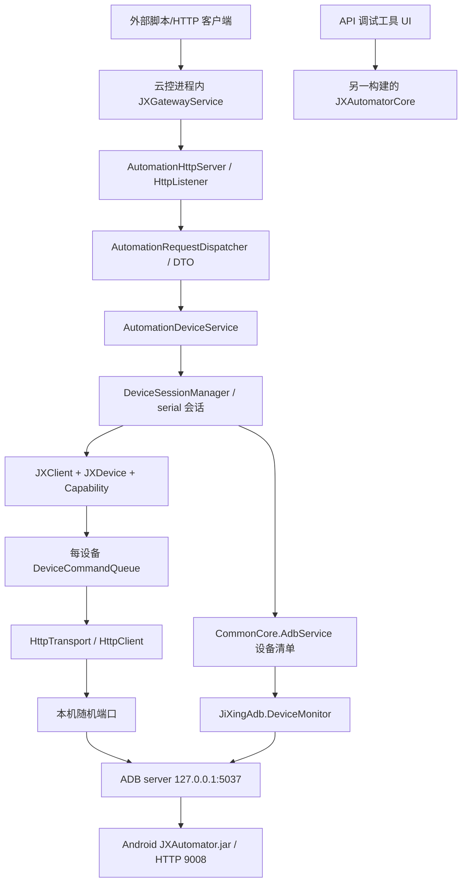

# 共享自动化、HTTP 网关与 ADB 通信逆向报告

> 开发参考资料，来自 2026-10-14 静态分析；不是已批准的首版建设规格，也不是当前运行结果。原始日志、CIL/IDA 导出、样本和资源中间文件已按用户清理要求移除。正文中的 token/RVA、evidence 路径仅保留为历史定位，不能当作现存文件；动态修正见 [已知问题](../KNOWN_ISSUES.md)，来源与可复核边界见 [来源说明](../SOURCES.md)。

分析日期：2026-10-14。范围：两个安装目录中的五个通信 DLL；仅静态读取、复制与 IDA CIL 反汇编，未执行目标程序、未连接设备、未访问应用云服务。

## 1. 结论与证据边界

两套软件共享 `JXAutomatorCore` 产品接口，但不是同一构建，也不是同一份手机端 JAR。云控公开一个电脑端 HTTP 网关；Core 本身另有手机端 HTTP 协议，通过 ADB 转发访问。**电脑端网关与设备端 HTTP 不能当成同一套 API。** 设备调试工具的 Core 保留公开 API 名称，内部类及字符串经过混淆；未恢复的私有字段/路由不由云控版本替代推断。

| 简称 | 原始文件                                                         | SHA-256                                                            | MVID                                   | MethodDef / IDA 函数 |
| -- | ------------------------------------------------------------ | ------------------------------------------------------------------ | -------------------------------------- | ------------------ |
| S  | `C:\Program Files\JiXingCloudControl\JXAutomatorService.dll` | `e6b700b0649ab5437dea739ec9ecb9adbd3da3d7eb74ed21dd290ce8ca4192c0` | `b45cef13-9251-49b3-9860-72a8b4b767f7` | 513 / 513          |
| C  | `C:\Program Files\JiXingCloudControl\JXAutomatorCore.dll`    | `cb446c659d9422d9c038b1d58cf8f6587feaffe51063794dd3682e1caf5ba51f` | `e9b223a5-214f-4bfc-8ddd-4651522146d0` | 461 / 461          |
| A  | `C:\Program Files\JiXingCloudControl\JiXingAdb.dll`          | `e2e002607afba603ad53eefd93e2228717bf3c1b0e6548278b087897badabff9` | `efd42ec4-ee24-4dd7-aba0-9201c935230c` | 540 / 540          |
| D  | `D:\Program Files\极星API调试工具\JXAutomatorCore.dll`             | `e3fa19e34f86a5103e54473049cbaf1022354a4f33f2707d3588f5e475195eb0` | `cb443a4e-4943-4ebd-8eae-06a5f74d7c78` | 682 / 682          |
| B  | `D:\Program Files\极星API调试工具\JXAdbCore.dll`                   | `4fb4c13688c899bf9380ba878bafd01286ac172b7b34742f9fd3510a8c6ee3ec` | `0c643e3b-1ba4-4e2f-ffc9-1f7fa7bf7b4d` | 578 / 578          |

五个 DLL 合计 2774 个 MethodDef 均由 IDA 导出（包含接口声明和编译器生成方法，不是 2774 个独立业务功能）。全量 IL 历史上位于 `disassembly/api-*-ida.json`（现已清理）。REA 元数据完整，但成员覆盖报告为 partial，主要有泛型签名解析限制；不能把条目数量匹配当作完整语义恢复。IDA CLI 的 EA 是合成地址，不是 native VA；下文统一引用“DLL 简称 + metadata token / PE RVA”。`evidence/api-*-index.json` 提供 token、RVA、IDA EA、CIL hash 与明文字符串锚点。

REA 成员证据：S `ev_85ad663b11a5fc83ff5bde5e70f7f45a42c1668940c4eb9c729c58861a58f636`；C `ev_597e6ad4b5f1d3a98ef704af73863fc7338bc9b1189f939e8cb5492173a5f8e9`；A `ev_78fb16f3ef7eff1d810ac336ca87f33c68066a9013f87289d6c12cfcd4960de9`；D `ev_57d90465f16d2e6dfd22653253d276377b3ff267a6aba58a5b5d7741dbc64bb9`；B `ev_a28407233cbf370160f2e263abd7a75e152978dfe6a0be01ad720884acbff77a`。历史完整记录原路径为 `evidence/api-rea.json`（已清理）。

## 2. 分层、进程与线程

S 的网关是宿主进程内对象，未看到独立 Windows service 入口；构造顺序为 SessionManager → AutomationDeviceService → Dispatcher → HttpServer（S `JXGatewayService..ctor` `0x06000023 / 0x2610`）。它的具体宿主启停入口应结合主 EXE 报告。

`AutomationHttpServer.Start` 开始监听并 `Task.Run(AcceptLoopAsync)`；接受连接后另起 Task 分派请求（S `0x06000182 / 0x470C`、`<AcceptLoopAsync>d__12.MoveNext`）。这允许并发 HTTP 请求，但不是线程数与设备数一一对应。C 的 `DeviceCommandQueue` 使用 `SemaphoreSlim(1,1)`，串行化同一设备的受控命令（C `0x06000004 / 0x207F`）；跨设备没有这个全局锁。`JXClient.Connect(serial)` 还用按 serial 保存的启动锁和客户端缓存，避免重复部署；缓存带引用计数（C `0x06000179 / 0x5A68`）。

A 的设备监控使用命名后台线程 `JiXingAdb.DeviceMonitor`，订阅 `host:track-devices`，读取变化并触发 connected/disconnected/changed 事件；遇空响应或 SocketException 有重连路径（A `Start 0x0600009F / 0x531C`、`InitializeSocket 0x060000A1 / 0x544C`、`DeviceMonitorLoop 0x060000A4 / 0x56B4`）。

## 3. 两层网络协议

| 边界                   | 协议、端口                                                       | 依据                                                                                |
| -------------------- | ----------------------------------------------------------- | --------------------------------------------------------------------------------- |
| 外部程序 → 云控网关          | 默认 `http://127.0.0.1:17171/`；Host、Port、Prefix 可配置。宿主可能覆盖默认值 | S `ServerOptions..ctor 0x06000172 / 0x4372`、`GetListenPrefix 0x06000170 / 0x431B` |
| PC Core → 手机 agent   | HTTP；本机随机空闲端口，经 ADB forward 到设备 TCP 9008                    | C `<CreateNewClientAsync>d__20.MoveNext 0x0600017B / 0x5D14`，常量 `0x2330=9008`     |
| PC Core → ADB server | TCP `127.0.0.1:5037`，ADB smart socket                       | C `<ForwardAsync>d__3.MoveNext 0x0600018A / 0x7030`，`0x13AD=5037`                 |
| ADB → Android        | transport 选择设备，sync 推送文件，shell 启动 agent                     | C `<PushEmbeddedJarAsync>d__2.MoveNext 0x06000190 / 0x763C`                       |

ADB 请求以 ASCII 四位十六进制长度（`X4`）加 payload 编码，响应读取 `OKAY` 或 `FAIL`，失败再读取长度及错误文本。端口转发 payload 为 `host-serial:{serial}:forward:tcp:{local};tcp:{device}`；推送使用 `sync:`、`SEND`、`DATA`、`DONE`、`OKAY/FAIL`。依据 C `0x060001AA / 0x8DF4`、`0x060001A8 / 0x8BA4`、`0x060001AC / 0x9034`。

云控网关把路径去除首尾 `/`、可选的 `api/` 前缀并转小写（S `NormalizePath 0x0600017D / 0x4634`）。仅分派 GET/POST，其他方法为 HTTP 405/code 1005。输出 UTF-8 JSON，camelCase，忽略 null 字段：成功形如 `{"code":0,"message":"ok","data":...}`；失败 data=null 被忽略。依据 S `0x06000173 / 0x439B`、`ApiEnvelope.Ok 0x060000CE / 0x3D3B`、`WriteSuccessAsync 0x0600017B / 0x45FF`。

## 4. 网关完整路由表（当前 S 构建）

所有 POST 请求包含 `serial`；首个调用自动创建会话。`GET /devices` 只列设备。未在当前分派器看到 `connect` / `disconnect` 路由，虽然程序集内部有同名会话方法。

依据：GET 分派 S `0x06000176 / 0x444C`；27 个 POST 分派在状态机 S `0x060001CA / 0x6974`；每条 DTO/handler 的目标在同方法的 `ldftn` 指令，具体方法 token/RVA 见索引。

| 方法/路径（可加 `/api/`）              | 除 serial 外的请求字段                             | handler / 结果                                         |
| ------------------------------ | ------------------------------------------- | ---------------------------------------------------- |
| GET `health`                   | 无                                           | running、prefix                                       |
| GET `devices`                  | 无                                           | 设备列表（由 CommonCore 设备模型映射）                            |
| POST `device/dump`             | 无                                           | DumpAsync → AndroidNodeDto 树                         |
| POST `device/screenshot`       | x,y,width,height,quality 可空                 | ScreenshotAsync → format=`png`、base64                |
| POST `device/shell`            | command                                     | ShellAsync → output                                  |
| POST `device/execute`          | command                                     | ExecuteShellAsync → output；当前 C 中 Execute 是 Shell 别名 |
| POST `device/set-prop`         | prop,value                                  | SetPropAsync → value(bool)                           |
| POST `device/set-timezone`     | timezone                                    | SetTimezoneAsync → value(bool)                       |
| POST `device/set-sim-info`     | operatorName,mcc,mnc,iccid,imsi,phoneNumber | SetSimInfoAsync → value(bool)；能力效果依赖设备环境             |
| POST `app/list`                | showSystem=false,needVersion=true           | GetAppsAsync → AppInfoModel 列表                       |
| POST `app/list-packages`       | 无                                           | GetPackagesAsync → string[]                          |
| POST `app/start`               | packageName                                 | StartAppAsync                                        |
| POST `app/stop`                | packageName                                 | StopAppAsync                                         |
| POST `app/clear`               | packageName                                 | ClearAppAsync → value(bool)                          |
| POST `input/tap`               | x,y                                         | TapAsync                                             |
| POST `input/swipe`             | x1,y1,x2,y2,steps=55,stepMs=5               | SwipeAsync                                           |
| POST `input/keyevent`          | code                                        | KeyeventAsync                                        |
| POST `service/info`            | 无                                           | GetServiceInfoAsync → ServiceInfo                    |
| POST `service/stop`            | 无                                           | StopServiceAsync                                     |
| POST `function/sleep`          | seconds 可空                                  | SleepAsync                                           |
| POST `function/sleep-ms`       | milliseconds 可空                             | SleepMillisecondsAsync                               |
| POST `element/find`            | selector                                    | FindAsync → 节点                                       |
| POST `element/find-all`        | selector                                    | FindAllAsync → 节点列表                                  |
| POST `element/wait-exists`     | selector,timeoutMs=3000,pollMs=200          | WaitExistsAsync                                      |
| POST `element/click-if-exists` | selector,timeoutMs=3000,pollMs=200          | ClickIfExistsAsync                                   |
| POST `element/click-text`      | text,timeoutMs=3000,pollMs=200              | ClickTextAsync                                       |
| POST `element/set-text`        | selector,text                               | SetTextAsync                                         |
| POST `element/wait-any`        | selectors[],timeoutMs=3000,pollMs=200       | WaitAnyAsync → index、selector、node                   |
| POST `element/click-node`      | node                                        | ClickNodeAsync                                       |

`SelectorDto` 字段：text、textContains、resourceId、className、instance、index、packageName、clickable、enabled、focusable、focused、scrollable、longClickable、checkable、checked、selected、visibleToUser。数字/布尔条件用 Nullable 表示“不限制”，不能把缺省 false 当作筛选 false。

`AndroidNodeDto` 除以上节点属性外，含 contentDesc、bounds、childNodeList；bounds 含 left/top/right/bottom/centerX/centerY/width/height。`DeviceSession` 含 serial、localPort、deviceModel、device、lastSeenUtc；字段存在不等于每个字段都在已观察路径赋值，ConnectAsync 未使用 localPort 赋值。

错误可观察映射：未知路由 404/code1006；不允许方法 405/code1005；执行分支存在 400/code1007、404/code1002、409/code1003、500/code2000。具体异常类型需结合异常区域类型解析，不在本表凭状态码补写。`DispatchAsync` 顶层异常另有 500 分支，故不能笼统保证所有坏 JSON 均为400。依据 S `0x060001C4 / 0x5F30`、`0x060001C8 / 0x6414`。

## 5. 设备端 HTTP 客户端契约（C 构建）

这部分请求从 PC Core 发往手机 JAR，不含网关的 `serial` 字段；设备由转发端口绑定。

| 能力                          | 路由/动词                                | 数据                                                           |
| --------------------------- | ------------------------------------ | ------------------------------------------------------------ |
| AppApi.ListAsync            | GET `app/list`                       | 返回应用                                                         |
| AppApi.StartAsync/StopAsync | POST `app/start`、`app/stop`          | JSON `package`                                               |
| DeviceApi.Dump              | GET `device/dump`                    | query `compressed=true/false`                                |
| DeviceApi.Shell             | POST `device/cmd`                    | body `cmd`                                                   |
| DeviceApi.Screenshot        | GET `device/screenshot`              | query x/y/width/height/quality 可选，结果解码base64（支持去除data URI前缀） |
| InfoApi.Detail              | GET `info/detail`                    | 设备详情                                                         |
| InputApi.Tap                | POST `input/tap`                     | x,y                                                          |
| InputApi.Swipe              | POST `input/swipe`                   | x1,y1,x2,y2,steps,stepMs                                     |
| InputApi.Keyevent           | POST `input/keyevent`                | code                                                         |
| NodeApi.Info/Exists         | GET `node/info`、`node/existsVisible` | selector query                                               |
| NodeApi.Click/LongClick     | POST `node/click`、`node/long-click`  | selector body                                                |
| NodeApi.SetText             | POST `node/set-text`                 | selector + `set_text`                                        |
| ServiceApi.Info/Stop        | GET `service/info`、`service/stop`    | 服务状态/停止                                                      |

来源为 C `JXAutomatorCore.Api.*` 各方法与 `NodeSelector.ToQuery 0x06000081 / 0x2F7C`。`HttpTransport` 默认超时 15 秒，每请求创建 HttpClient，设置 ConnectionClose，UTF-8 application/json，解析 `JXResponse<T>` 的 code/message/data；HTTP 非成功、API code 非零、空/错误 JSON 产生 `JXApiException`。依据 C `0x06000041 / 0x2AC8`、`0x06000044 / 0x2C84`、`<SendAsync>d__4.MoveNext 0x0600017F / 0x6630`。这描述客户端发出的契约，未证明 JAR 对所有输入的服务端行为。

## 6. 关键控制流与算法

1. **会话建立**：网关验证 request/action/serial，查 CommonCore 设备表，调用 SessionManager.ConnectAsync；后者检查设备存在及 Online（枚举值2），命中缓存就更新 lastSeenUtc，否则调用 JXClient.Connect 并建 DeviceSession。依据 S `0x060001B0 / 0x55D8`、`0x060001BA / 0x5B5C`。
2. **agent 启动**：C Connect 获取 serial 锁、双查缓存；构造默认 `/data/local/tmp/JXAutomator.jar`；先检测已运行进程，复用合法 forward 或新建。若未运行，清理该设备9008旧转发、校验并推送 JAR、建立转发，执行 `CLASSPATH={jar} app_process / com.jixing.automator.auto.Main --port 9008`。JAR SHA 相同时跳过推送。依据 C `0x06000179 / 0x5A68`、`0x0600017B / 0x5D14`、`0x06000190 / 0x763C`、`0x0600019E / 0x84CC`。
3. **启动探测**：默认 StartupTimeout=20s、ProbeTimeout=1.5s、PollInterval=200ms。探测是本地 TCP 可连接性，成功后固定等5s返回；它不是 HTTP `/health` 内容验证。超时 Dispose 并抛 JXApiException（C `0x0600017B / 0x5D14`）。

1. **节点搜索**：S AndroidNodeSearchService 先检查根节点，再按 childNodeList 顺序递归，匹配条件做 AND；缺省条件通过，字符串精确匹配和 contains 使用 Ordinal 比较（区分大小写）。依据 S `Traverse 0x06000034 / 0x28EC`、`IsMatch 0x06000035 / 0x294C`、`MatchesString/Contains 0x06000036/37 / 0x2AAA/0x2AC7`。
2. **等待节点**：C WaitExistsAsync 用 TickCount、循环 ExistsAsync、Delay(pollMs)、超时返回；WaitAny 按输入选择器顺序逐个检查，第一个存在的 selector 再读 InfoAsync，返回 index/selector/node。不是一次并行 OR 查询。依据 C `0x06000174 / 0x588C`、`0x06000172 / 0x555C`。
3. **ADB 服务控制**：A StartServer 查询服务版本/状态和5037持有者路径，必要时 `host:kill` 后启动所选 adb.exe。两程序同时运行可能争用全局5037；这是静态代码可见的交互风险，不是已实测冲突（A `0x06000061 / 0x3FB8`、`0x06000065 / 0x4350`）。

## 7. 日志、配置与两个程序的关联

- S 使用 ServerOptions（host/port/prefix/connectTimeoutMs）内存配置；未在该 DLL 发现配置文件读写调用。宿主的保存位置以主程序报告为准。部分 timeout 属性虽存在，不能仅凭 DTO 断言已贯穿全部启动路径。
- C 引导代码引用 `/data/local/tmp/JXAutomator.startup.log` 并在准备时删除旧文件；实际 app_process 启动字符串未把输出重定向该文件，所以不能说该版本必然写启动日志。后台 shell 启动委托包含吞异常路径，最后主要靠 TCP 探测/超时报告故障。
- A 有 `AdbTrace.WriteLine` 和 System.Diagnostics.Trace，记录启动前后状态、adb路径、监控重试；最终日志输出位置取决于宿主 Trace 配置。
- D 额外含 HttpTraceUtil.Enable/Disable/RegisterBaseUrl/ResolveSerial/Trace，Trace 在启用的 serial 下组合请求响应信息，锁定写入 UTF-8 AppendAllText，同时 Console.Write；文件路径字符串被混淆，未解码前不指定实际路径（D `Trace 0x060002A1 / 0xE55C`）。
- 两者具有争用同一 ADB server 和设备 agent 的潜在运行时边界。云控 Core 的设备端口9008已由 IL 确认；调试 Core 的混淆字符串/默认端口尚未在本报告独立解码，不能据云控值断言两者默认端口完全相同。**共享运行时边界不证明调试工具必须通过云控网关调用。** Core 提供直连设备和直接 baseUrl 入口；是否由调试 UI 调用网关应查主 EXE 调用链。
- 嵌入 JAR 已独立提取校验：云控473210字节，SHA256 `37ab37322ec2fc4e72b0d8ea6f227a7ad81fbe3048e5773f75f8bed00d960133`；调试474287字节，SHA256 `1e485a6455826839aa9702801557f4d8e6f2d222ea2261ef7a511121b1738fb1`。目前仅确认不同，不能由大小判断哪版更新或更完整。
- D 公开接口比 C 增加 SetLanguage、GetChildrenAsync/GetParentAsync、节点正则/前缀匹配、Description 类选择条件、HttpTraceUtil。名称和签名/委托调用提供静态依据；内部混淆逻辑未全部重构，不能把 C 的全部参数行为套用到 D。

REA 两个 Core 的结构比较保存为 `ev_dafee11c80f06ba38c3a6a4a5076030737bf79ccaab888c29f1d35e43be838ff`，覆盖 partial。混淆及未解析泛型会制造大量 unmatched/unknown；比较器的 added/removed 不能直接当产品功能增减。

## 8. 对 PRD/spec/uispec 的约束

- PRD 可确认的能力：多设备识别、按serial执行、截图/控件树检查、坐标与selector操作、应用管理、服务状态、等待与条件点击、结构化错误、HTTP对接。
- spec 应明确四层：宿主UI、HTTP网关、每设备Core队列、ADB+Android agent；为每台设备分别管理状态、超时和日志。网关API与device API分别建契约表。
- uispec 可由 DTO 推导必要输入字段、缺省值和响应展示，但本 DLL 没有窗口布局证据；具体位置、颜色、控件类型必须由主 EXE 资源/构造函数证明。
- 复刻实现建议将“串行命令 + 跨设备并行”设为验收条件；启动就绪改为实际HTTP版本/健康校验是建议，不能标注成原程序已有行为。
- 当前材料不支持20台并发性能、任意Android版本兼容、全量ROM功能、风控检测通过率等结论。JAR内部服务端算法、两客户端同时操作一设备的结果、真实文件路径与连接成功率仍需后续验证。

可复刻的控制流见 `PSEUDOCODE.md`；它是根据 IL 重构的语义伪代码，不是原始源码，未编译运行。
