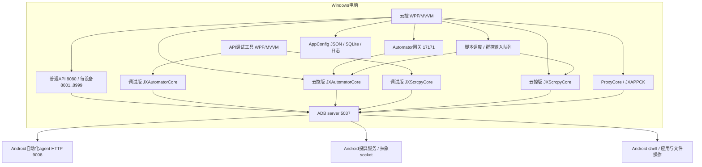

# 极星 API 调试工具与极星云控：系统性静态逆向报告

> 开发参考资料，来自 2026-10-14 静态分析；不是已批准的首版建设规格，也不是当前运行结果。原始日志、CIL/IDA 导出、样本和资源中间文件已按用户清理要求移除。正文中的 token/RVA、evidence 路径仅保留为历史定位，不能当作现存文件；动态修正见 [已知问题](../KNOWN_ISSUES.md)，来源与可复核边界见 [来源说明](../SOURCES.md)。

分析日期：2026-10-14。样本来源：用户指定的两个安装目录，以及 `yuanshiwenjian` 中两个原始EXE。方法：REA托管证据提取、IDA原生/CLI全量自动分析、CIL调用链审阅、资源和原始IL字节交叉校验。

**核心结论：两者是同一设备工具体系中的两个独立桌面宿主。调试工具面向单设备观察与调试，云控面向设备墙、同步输入、批处理、脚本及本地API服务。二者主要通过共同使用ADB和设备端服务产生关联，本轮未发现“调试工具必须经云控进程转发”的证据。** 同名DLL与手机端JAR属于不同构建；未经兼容性验证，不应假定可直接互换。

已完成两个主程序集及13个相关托管DLL的全部MethodDef条目反汇编导出，共31,055项；两个安装器另外导出7,077个IDA识别函数。核心控制流已重构成语义伪代码，并反推PRD、spec、uispec。**这是完整方法清单与可解码CIL的导出，加上核心流程解释；不是所有方法、第三方依赖、手机ROM及动态行为的完整语义恢复。** 未恢复的内容见覆盖矩阵与第8节。

## 交付导航

| 文档 | 内容 |
|---|---|
| [PRD](PRD.md) | 从两个程序反推的产品目标、功能范围、优先级及待执行验收 |
| [spec](spec.md) | 架构、状态、三类HTTP边界、ADB、数据结构、配置与验证规格 |
| [uispec](uispec.md) | 两程序的信息架构、页面、字段、交互与状态；不冒充像素级还原 |
| [伪代码总集](PSEUDOCODE.md) | 调试、云控、API及共享模块的控制流重构 |
| [调试工具详细分析](DEBUG.md) | 入口、混淆类型映射、节点树/取色/投屏/Shell/应用/文件流程 |
| [调试工具共享库补充](DEBUG_SHARED.md) | 调试版投屏、公共服务和日志行为的版本差异 |
| [云控详细分析](CLOUD.md) | 初始化、群控、脚本、本地API、持久化、本地化 |
| [自动化与ADB详细分析](API.md) | 27条网关POST路由、手机HTTP客户端契约、会话/队列/引导 |
| [投屏、代理、日志、备份分析](SHARED.md) | 帧与输入格式、MOVE合并、代理生命周期、日志、备份 |
| 审阅与验证（历史定位：`reports/verification-review.md`，原文件已清理） | 独立审阅、修正与剩余证据边界 |

## 1. 程序与安装器身份

| 对象 | SHA-256 / 入口 | 识别结果 |
|---|---|---|
| `D:\Program Files\极星API调试工具\JXAutomatorDebugUI.exe` | `6b7c79177172335738f7c28a36c579b75efad0c03efbb5478b79e374943bc49a`；Main token `0x06000868`、RVA `0x28324` | .NET Framework 4.8、AnyCPU、WPF；程序集版本1.0.5.0 |
| `C:\Program Files\JiXingCloudControl\JiXingCloudControl.exe` | `48af9c992023d3b8765764138066a269cb68c77d88797f5a9a27fdb3339a9576`；Main token `0x060002bc`、RVA `0x19eec` | .NET Framework 4.8、PE32+ x64、WPF |
| 原始 `极星API调试工具-1.0.5(20260731).exe` | start VA `0x4b0028`；完整hash见 [来源说明](../SOURCES.md) | Inno Setup；打包标识 `Inno Setup Setup Data (6.5.2)`；46,560,504字节 |
| 原始 `极星云控-1.3.4-20261007.exe` | start VA `0x4b1e60`；完整hash见 [来源说明](../SOURCES.md) | Inno Setup；打包标识 `Inno Setup Setup Data (6.7.0)`；71,650,184字节 |

原始EXE的入口进入安装器，不是业务App.Main。安装器自动分析覆盖其已加载、可识别的原生代码；压缩载荷不是直接按x86代码解释。本次业务分析以安装后的实际文件为依据，没有重新运行安装器，也没有证明安装器压缩载荷与现有安装逐文件完全一致。

坐标规则：托管方法以“模块+token+PE RVA”为首要定位依据；IDA CLI EA是合成地址，不是Windows运行时VA。安装器的start则为IDA原生映像VA。混淆名称保留在证据中，报告用职责别名辅助阅读。

## 2. 整体架构与关联

图中的端口为默认或分配范围，不是本机监听实测。9008有云控Core明文代码依据；调试版私有字符串混淆，不能仅因公开类名一致就断定其全部内部协议相同。

两种PC到手机的链路同时存在：自动化为PC随机本地端口经ADB **forward** 访问设备HTTP；云控投屏为设备抽象socket经ADB **reverse** 连接PC监听端口。两套软件均依赖ADB基础设施，设备发现和服务重启可能争用全局5037；同设备部署不同版本JAR也可能冲突，尚未实测。

没有确认共享同一个持久化配置文件：云控使用自身AppConfig.json、db.sqlite3及脚本目录；调试工具使用自身设置/资源及配置。共享产品接口和ADB运行时，不等于共享数据库或要求彼此同时启动。

## 3. 功能清单与关键证据

| 功能 | 调试工具 | 云控 | 主要证据 |
|---|---|---|---|
| 设备发现 | ADB列表、网段TCP探测、连接与属性 | ADB启动、网段扫描、准入与恢复 | 调试 `0x06000169/17f`；云控 `0x060001bc` |
| 屏幕观察与控制 | 单设备投屏、截图、参数与坐标映射 | 设备墙、主控、小屏、共享解码和同步输入 | 调试 `0x06000668/000bd/000cf`；云控 `0x060001c0/031dd/03223` |
| UI自动化调试 | Dump、层级树、属性、矩形联动、JSON导出 | 经Automator支持selector查询/等待/点击 | 调试 `0x06000484/003d5/003de`；Service `0x06000034/35` |
| Shell/应用/文件 | Shell历史、安装卸载清数据、推送 | 多设备操作、双向文件同步、文本/剪贴板 | 调试 `0x06000521/0074a/00806`；云控 `0x06001a12/01f7f/01f80` |
| 脚本 | 本轮未确认通用脚本编辑/调度器 | .jxscript包、动作执行、按serial任务与取消 | 云控 `0x06003edb/03ef0/03f3f/03f40` |
| 对外API | 本轮未确认主EXE监听器；有HTTP客户端 | 普通设备API + 独立Automator网关 | 云控 `0x06002f92/0302f`；Service `0x06000172/001ca` |
| 代理和备份 | 本轮未确认对应桌面链 | root条件下代理部署、应用资料归档/恢复 | Proxy Start `0x060000ea`；JXAPPCK.Backup/Restore |
| 配置与日志 | .NET用户偏好、自有文件logger；调试CommonCore logger已证实为空实现 | JSON合并/原子替换、SQLite模式、分级异步日志 | 调试Common `0x060000d2`；云控 `0x060004d6/004dc/0281a`；云控Common `0x06000017/35/37` |

广告中的虚拟SIM、模拟LTE、免调试、检测通过等不能等同于这两个桌面程序的已验证能力。样本中确有SetSimInfo、环境配置字段等接口，但实际系统实现和检测结果属于手机端环境，未在本轮验证。

## 4. 初始化、调度与调用顺序

**调试工具：** Main → App构造/初始化日志和ADB → OnStartup初始化ScrcpySessionManager(Dispatcher) → 选择设备 → JXClient.Connect → Scrcpy Connect → Screenshot → Dump(true) → Messenger更新截图/层级/属性面板。关键token/RVA详见调试报告。节点覆盖层的NodeClickCommand只证明“选中节点”，不能据其名字认定为手机点击。

**云控：** Main → OnStartup单实例/日志/异常与事件注册 → LoadAppConfig/语言/登录启动窗 → 延迟ADB与投屏基础设施 → 登录及额度条件成立后扫描/补连 → 设备墙会话协调。主UI由Dispatcher更新；ADB监控、HTTP接受、输入worker、共享解码、脚本各有任务或工作线程，不能用20台设备推断恰好20条线程。

**同步输入：** 鼠标/键盘Router → Coordinator → 主输入FIFO/MOVE合并 → generation交接策略 → 源设备投递 → 每目标mailbox → 分辨率映射 → Scrcpy控制队列。不同目标可并行，同目标维持事件顺序。主要token：云控 `0x0600325d → 0x0600328b → 0x060031dd → 0x060031f7 → 0x06003223/03227`。

**脚本：** ZIP导入/校验 → manifest与steps → serial级CTS查重 → 逐步骤执行 → 日志事件 → finally按CTS身份清字典并释放。通用动作证据为launch/wait/click/swipe；Pause对应Cancel，没有已证实的断点续跑。脚本运行记录最多500条/设备。

**API自动化：** HTTP请求 → 路由/DTO → serial校验 → SessionManager → JXClient启动锁与缓存 → 部署或复用JAR/转发 → 每设备SemaphoreSlim队列 → 手机HTTP → 结构化返回。TCP就绪探测加固定等待，并不等同于手机HTTP语义健康检查。

## 5. 重要数据结构与协议

| 结构/边界 | 关键内容 | 依据 |
|---|---|---|
| DeviceModel / DeviceSession | serial、设备属性、屏幕尺寸；会话含device与lastSeenUtc等 | 两Core/Service成员元数据；`api-*-index.json` |
| AndroidNode / SelectorDto | text/resourceId/className/bounds/children；布尔/数字条件可空 | Service `0x06000035`及DTO字段；空条件不是false条件 |
| 输入请求与mailbox | 源设备、目标快照、坐标尺寸、generation、手势边界 | 云控 `0x060031dd/03223/0321b` |
| ScriptPackage | Manifest、Steps、Parameters；ZIP含manifest.json/script.json | 云控 `0x06003edb`；`cloud-schema.json` |
| AppConfig | 46个配置字段；墙列数、主/小屏、同步、API、语言、窗口等 | 云控 `0x060004d6/004dc`；字段 `0x04001b3f..1b6c` |
| 持久化实体 | 11类：组、设备关系、扫描、命令、脚本参数、环境、代理、服务器、备份、用户等 | `cloud-schema.json`；没有读取实际数据行 |
| 普通API响应 | `{ok,data}` 或 `{ok:false,message}` | 云控ApiDeviceRequestHandler |
| Automator响应 | `{code:0,message:"ok",data:...}`，忽略null | Service ApiEnvelope/WriteSuccess |
| 设备HTTP响应 | Core解析JXResponse&lt;T&gt;的code/message/data | Core HttpTransport状态机 `0x0600017f` |
| 视频包 | 12字节BE头+payload，config/keyframe标志 | 云控Scrcpy `0x060005e2 / 0x249c8` |
| 兼容触摸包 | 32字节：type/action/pointer/x/y/屏幕尺寸/pressure/button | 云控Scrcpy `0x0600058a / 0x2125c` |

完整路由、字段、错误分支及参数缺省值见[API详细表](API.md)与[技术规格](spec.md)。报告不会把8080、17171和9008三层的路径、字段、返回体混在一起。

## 6. 可复刻控制流与复刻边界

[伪代码总集](PSEUDOCODE.md)覆盖初始化、扫描、调试数据加载、坐标转换、节点联动、Shell、文件队列、配置保存、输入合并/分发、脚本加载/取消、HTTP路由、会话缓存/agent部署、设备队列/节点搜索，以及投屏/代理/日志。

可据此重新实现桌面编排和协议客户端；仍需补齐未恢复字符串、手机端兼容性及运行验证。伪代码没有原产品凭据，也不声称是可编译的完整源码。恢复出的云控字符串采用离线静态解码并以原始CIL校验；嵌入数据库口令在派生可读映射中脱敏，未用于打开数据库。

## 7. 覆盖矩阵与验证结果

| 分析对象 | MethodDef / 有CIL方法体 | 已做 |
|---|---:|---|
| 调试主EXE | 2284 / 2261 | REA元数据/调用边、IDA全量CIL、关键UI链、73项WPF资源提取 |
| 调试CommonCore / JXScrcpyCore | 219/212；689/639 | REA+IDA全量；日志/ADB/投屏差异 |
| 调试JXAutomatorCore / JXAdbCore | 682/671；578/461 | REA+IDA全量；公开API、队列、trace等；私有混淆仍有缺口 |
| 云控主EXE | 22120 / 21990 | REA+IDA全量；5530个字符串访问器静态恢复；核心链 |
| 云控SQLCore / LanguageCore | 91/87；67/67 | REA+IDA全量；配置数据库接口/本地化 |
| 云控JXAutomatorService / Core / JiXingAdb | 513/513；461/457；540/430 | REA+IDA全量；网关、客户端契约、引导与监控 |
| 云控Scrcpy / Proxy / Common / JXAPPCK | 1925/1822；330/295；424/424；132/113 | REA+IDA全量；共享模块核心流程 |
| 两个安装器 | 3531 + 3546个原生函数 | IDA自动分析/汇编全文、入口、Inno标识 |
| ADB/FFmpeg/SQLite/Xray/Hysteria等第三方二进制 | 未逐函数语义分析 | 依赖/资源/边界盘点；部分嵌入文件已提取 |
| 手机端JAR、ROM、内核 | 未完成内部语义逆向 | 两自动化JAR提取及SHA校验，桌面发出契约可见 |

`evidence/verification.json`记录15个托管模块、31,055个方法条目、30,442个有CIL方法体，REA报告方法体指令截断为0。复杂泛型签名仍有限制，REA整体partial状态保留。113个原安装代码文件的SHA256与初始盘点一致。静态阶段曾保存 IDA 分析数据库和导出物，本次按用户要求已移入回收站；未用补丁修改目标代码。

本轮验证包括字节hash、方法数量、token/RVA/EA索引、关键IL分支及独立审阅。没有运行目标、安装器、登录、API请求、ADB操作、数据库迁移或20台并发测试；因此这些不能标为通过。

## 8. 未完成语义与下一阶段验证

1. 调试版混淆字符串、复杂泛型/反射调用、全部BAML到XAML的还原仍不完整。
2. 手机端JAR内部实现和定制ROM能力没有全面逆向；不能承诺环境检测兼容性。
3. 两款客户端同时操作同设备的映射/JAR冲突、HTTP实际监听绑定、登录后页面可达性均待运行验证。
4. 20台性能需要分辨率/FPS/码率、CPU/GPU、USB/网络拓扑作为条件，不能以代码中存在设备墙作为容量证据。
5. 恢复应用资料会清当前应用数据；代理会改设备路由。后续受控验证应使用专用测试设备和可恢复数据，并另行确定运行范围。

若目标仍是此前确定的“20台ADB设备，电脑群控＋脚本/API”，建议先验证设备目录、单屏控制、保序同步和可取消脚本，再验证20台。更简单的原型是现有ADB/投屏库配小型脚本服务；完整复刻代理、环境配置、账号和备份会显著增加测试与维护成本。拒绝把所有混淆DLL直接拼入新产品：版本绑定与未知内部行为会妨碍定位问题。具体取舍和推翻条件见PRD末尾。
