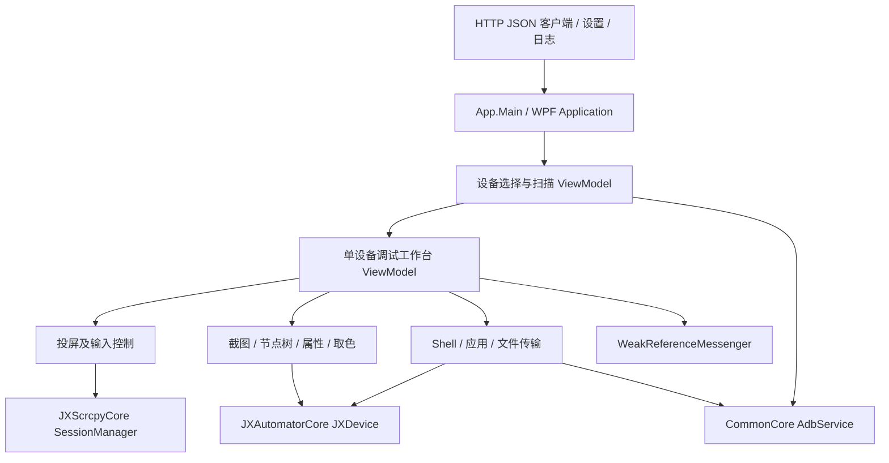

# 极星 API 调试工具：主程序集静态逆向

> 开发参考资料，来自 2026-10-14 静态分析；不是已批准的首版建设规格，也不是当前运行结果。原始日志、CIL/IDA 导出、样本和资源中间文件已按用户清理要求移除。正文中的 token/RVA、evidence 路径仅保留为历史定位，不能当作现存文件；动态修正见 [已知问题](../KNOWN_ISSUES.md)，来源与可复核边界见 [来源说明](../SOURCES.md)。

分析日期：2026-10-14。目标仅为 `D:\Program Files\极星API调试工具\JXAutomatorDebugUI.exe`，以及主程序引用到的接口；核心 DLL 的实现另见 API/核心库分析。未启动目标、未连接手机、未修改安装目录。

## 1. 身份、证据与覆盖范围

- SHA-256：`6b7c79177172335738f7c28a36c579b75efad0c03efbb5478b79e374943bc49a`；大小 1,890,304 字节；MVID：`9f0f777f-bf6f-4b85-3f2a-fb8593b355cf`。
- 身份证据：REA `ev_40deb09520a6badc12eec4bbce7810c70c941346473c3b614306567f29f334f2`（父分析取得）；.NET Framework 4.8、AnyCPU、WPF。
- 成员证据：REA `ev_514a44b0f1beeb3209403bdaa902196d400e7ad8906a5fd7cc4a0c2af1948212`，历史记录原路径为 `../evidence/debug-rea.json`（已清理）。327 个类型、2,284 个方法条目；其中 2,261 个有 CIL 方法体、23 个无方法体；没有方法体解码 issue、没有指令截断，但 REA 总覆盖仍标记 `partial`，不能自行改称完整语义恢复。
- IDA 的 CLI 分析导出：`../evidence/debug-ida-functions.json` 的 `assembly` 数组与 `../evidence/debug-full.il.txt`。所有 2,284 方法条目已建立 `../evidence/debug-function-map.csv` 映射；`instructions` 字段曾只保留同地址首行，分析采用修正后的 `assembly`。
- **地址约定：**下列 token 是此 SHA/MVID 的构建内元数据坐标；RVA 是 PE 方法体 RVA；IDA CLI EA 是 IDA CLI 处理器坐标。三者不可混用，CLI EA 不是 Windows 原生进程虚拟地址。
- 多数业务类型/方法名被重命名，字符串经 `0x06000323 → 0x06000324` 的资源解码函数间接取得。没有把其解密后的字符串、UI 文案、远程 URL 当作已知。

本文“观察”表示文件字节、元数据或 CIL 中直接出现；“推导”表示根据多个调用点重构；“未知”表示本轮没有足够证据。可读伪代码是控制流重构，不是原始源代码。

## 2. 程序概述与架构

**观察：这是 Android 设备调试工作台，主程序集承担 WPF 界面、MVVM 状态、交互编排和辅助 HTTP 请求。**投屏、ADB 和设备自动化分别交给 `JXScrcpyCore`、`CommonCore/JXAdbCore`、`JXAutomatorCore`，并非所有能力都在 EXE 中实现。

主要类型的职责是按保留属性、命令名及调用推导，混淆类型别名不等于原始类名：

| 类型标识 | 角色与依据 |
|---|---|
| `JXAutomatorDebugUI.App`，`0x02000135` | 入口、服务初始化、WPF Dispatcher、退出清理 |
| `-.l1iliiiIIi11l`，`0x020000db` | 设备目录：DeviceCollection、SearchQuery、ScanRangeCollection、DeviceStartCommand、RestartAdbCommand |
| `-.IIi1lI11lllI`，`0x020000a7` | 调试主视图：SelectDeviceOB、AutoDevice、MainTab、LoadUIDumpCommand、截图和设置命令 |
| `0x0200002e` | 投屏 ViewModel：ScreenCastSource、分辨率/FPS/码率及 Applied/Selected 双状态、返回/Home/任务键 |
| `-.IIi1l1I111lI`，`0x0200009f` | 节点矩形覆盖层：NodeRectangleList、UIDumpImage、NodeClickCommand |
| `-.l1ilI1iIliIIl`，`0x020000d8` | 节点树与属性、四类搜索过滤、结构导出 |
| `-.l1I1l11l1iIl`，`0x020000c4` | Shell 输入、命令历史、执行状态与输出 |
| `-.lli1l1l11iIl`，`0x02000111` | 应用列表、筛选、安装、卸载、清数据及文件传输入口 |
| `-.lIlll1l1il1I`，`0x02000104` | 传输队列、目标目录、整体进度、APK 自动安装 |
| `-.l1lIiIli1il11`，`0x020000ff` | 截图、缩放/平移、裁剪、保存待确认裁剪 |
| `-.l1IIiIillIi1i`，`0x020000c6` | 图像取色、HEX/RGB、设备坐标、颜色历史 |

**进程/线程模型：**主进程为 WPF Application，UI 工作由 Dispatcher 承担；大量 AsyncRelayCommand、Task、编译器异步状态机、ConfigureAwait(false)；跨 ViewModel 使用 WeakReferenceMessenger。扫描计数、日志写入使用 Monitor 锁。调用 StartService/CMDExcute 证明依赖 ADB 服务接口，但 EXE 此范围不足以断言启动的子进程总数、线程数量或运行时负载。

## 3. 功能清单与关键节点

| 功能 / 节点 | token / PE RVA / IDA CLI EA | 静态证据、输入输出 |
|---|---|---|
| 程序入口 `App.Main` | `0x06000868` / `0x28324` / `0x274e0` | new App → InitializeComponent → Application.Run |
| `App..ctor` | `0x06000857` / `0x27C7C` / `0x26e70` | 设计模式检查；初始化日志；设置网络选项；AdbService.StartService；读取自身版本 |
| `App.OnStartup` | `0x0600085e` / `0x27EB4` / `0x270c0` | ScrcpySessionManager.Default.Initialize(Application.Current.Dispatcher)，启动异步任务 |
| 设备扫描单个地址 | `0x0600017f` / `0x902C` / `0x73e0` | IP/端口/超时 → TcpClient.BeginConnect → WaitOne → EndConnect；成功后 AdbService.Connect；更新发现/连接计数 |
| 枚举设备 | `0x06000169` / `0x8124` / `0x6650` | AdbService.Devices/GetProp/GetScreenSize/ExecuteRemoteCommand → DeviceModel 列表 |
| 自动化连接重试 | `0x06000674` / `0x1D05C` / `0x1c150` | serial → 准备连接 → JXClient.Connect(serial, token, null)，失败退避 800ms；上限取决于 serial 分类 |
| 连接后准备调试上下文 | `0x06000668` / `0x1C444` / `0x1b5d0` | DeviceModel/JXDevice → Scrcpy ConnectAsync → Screenshot → Dump(true) → 聚合结果；各步骤有独立异常处理 |
| 投屏配置构造 | `0x060000bd` / `0x49C0` / `0x2d40` | serial、SelectedResolution/FrameRate/BitRateKbps → ScrcpyOptions；ControlEnabled=true，AudioEnabled=false，ConnectTimeout=8s |
| 输入坐标映射 | `0x060000cf` / `0x4DBC` / `0x3130` | UI 点、显示尺寸、VideoWidth/Height → Position(ScreenSize, Point)；缩放后夹取到视频边界；非法尺寸返回 null |
| 刷新截图与节点树 | `0x06000484` / `0x14B6C` / `0x13910` | AutoDevice → Screenshot 后 Dump(true)；通过 Messenger 分别通知；IsLoadUIDump 控制重入与忙状态 |
| 节点矩形递归 | `0x060003d5` / `0x1242C` / `0x10fa0` | AndroidNode/Bounds/ChildNodeList → 矩形列表；深度和渲染顺序向下传递 |
| 矩形与树选择联动 | `0x060003de` / `0x12834` / `0x11370` | 清旧 IsSelected、置新选择，发送 SourceNode 消息；不是在手机上执行点击的证据 |
| Shell 执行状态机 | `0x06000521` / `0x17248` / `0x161e0` | 非空 CurrentInput → Trim → JXDevice.Shell → 历史项与输出；清输入、复位历史游标，finally 解除 IsExecuting |
| HTTP 客户端创建 | `0x06000076` / `0x335C` / `0x1650` | HttpClient.BaseAddress 来自另一个函数；Timeout=30s |
| 通用 HTTP 请求状态机 | `0x06000079` / `0x33F0` / `0x16f0` | 方法、URI、对象体、headers、token → JSON UTF-8 body → SendAsync → ReadAsStringAsync → T/string；失败日志并抛异常 |
| 应用列表状态机 | `0x060007ff` / `0x24924` / `0x23be0` | 两个 JXDevice.AppList 调用、结果合并，存在 Shell 回退及包名归并逻辑 |
| 清应用数据 | `0x06000806` / `0x250D0` / `0x24330` | AppInfoModel.Package → JXDevice.AppClear(package, token) → bool |
| 文件推送/安装 | `0x0600074a` / `0x21704` / `0x208b0`；`0x060007b8` / `0x23484` / `0x22750` | AdbService.Push，支持 progress/cancellation；安装路径 Push→InstallFromDevice→Delete；另有 InstallApk/InstallApkSet |
| 日志初始化/写入 | `0x06000394` / `0x11454` / `0xffc0`；`0x06000398` / `0x11544` / `0x100b0` | BaseDirectory 下建目录；日期参与文件名；UTF-8 创建/追加，时间/级别/类别/消息/异常；Monitor 锁；写入函数吞异常 |
| 用户投屏偏好 | `0x06000887–0x0600088c` | ApplicationSettingsBase/SettingsBase 索引器保存三个整数属性；有 getter/setter，但具体 user.config 路径未运行验证 |

命令到处理函数的绑定直接来自 `ldftn`，不是同名猜测：

- LoadUIDumpCommand `0x06000468` → `0x06000413` → 异步状态机 `0x06000484`。
- DeviceStartCommand `0x06000646` → `0x060005e0`，后续连接/准备状态机包括 `0x06000697`、`0x06000674`、`0x06000668`。
- RefreshDevicesCommand `0x06000649` → `0x060005e3`。
- ExecuteCommand `0x0600051e` → `0x0600050c` → 状态机 `0x06000521`；CanExecute 为 `0x0600050b`。
- ExportStructureCommand `0x060005c2` → `0x06000593` → 状态机 `0x060005c8`；JSON 递归节点 `0x06000597`、Bounds 对象 `0x06000598`、写文件 `0x060005c7`。
- StartTransferCommand `0x0600075c` → `0x0600073a`；CanExecute 为 `0x06000767`。
- UninstallAppCommand `0x060007ed` → `0x060007b1`；ClearAppDataCommand `0x060007ee` → `0x060007b2`。

## 4. 数据结构与界面约束

**观察到的关键数据：**

- `DeviceModel`：Serial、ScreenSize 及设备属性；设备行还暴露 ShowName、Model、Product、Brand、AndroidVersionDisplay、ResolutionDisplay、IsLoadService、IsSelected。
- `AndroidNode`：Index、ClassName、ResourceId、Text、Bounds、ChildNodeList，并读取 Clickable、LongClickable、Description 等属性。树节点包装类 `0x0200006d` 保留 Children、SourceAndroidNode、IsExpanded、IsSelect、ResourceIdShort、TextQuoted。
- 矩形包装 `0x02000009`：X/Y/Width/Height、Stroke/FillColor、Depth、RenderOrder、EffectiveZIndex、IsSelected、SourceNode。矩形模型与原始节点保持引用，支撑双向选中。
- 扫描行 `0x02000079`：Id、StartIp、EndIp、Port、FoundCount、ConnectedCount、IsScanning。
- 传输行 `0x020000fd`：LocalPath、FileName、SizeText、IsApk、AutoInstall、State、ProgressPercent；队列另有 TargetFolder、IsTransferring、OverallProgressPercent。
- Shell 历史项 `0x02000004`：Index、Time、CommandText、OutputText、RelativeTimeText。

父分析进一步纯静态提取了 WPF 资源：`../evidence/debug-resources/wpf/resources.tsv` 共 73 项。`ResourceReader.GetResourceData` 只读原始资源，未加载目标程序集。下列实际资源名与上述职责相互印证：

| 原资源路径 | 提取文件 | 作用 |
|---|---|---|
| `view/mainwindow.baml`、`view/debugview.baml` | `0067.baml`、`0066.baml` | 主窗口、调试工作台 |
| `view/devicelistview.baml`、`view/devicelistemptystateview.baml` | `0018.baml`、`0028.baml` | 设备目录与空状态 |
| `view/uidumpview.baml`、`view/uilevelview.baml` | `0005.baml`、`0017.baml` | 截图节点覆盖层与层级树 |
| `view/screencastview.baml`、`view/screencastshellview.baml`、`view/devicecontrolview.baml` | `0032.baml`、`0031.baml`、`0052.baml` | 投屏及控制容器 |
| `view/shellview.baml`、`view/appmanageview.baml` | `0026.baml`、`0016.baml` | Shell 与应用管理 |
| `view/transfermanageview.baml`、`view/transferpathpickerwindow.baml` | `0049.baml`、`0061.baml` | 传输队列与目录选择 |
| `view/screenshotview.baml`、`view/colorminiview.baml` | `0071.baml`、`0054.baml` | 截图操作与取色 |
| `view/settingsdialogcontentview.baml`、`view/versionupdatedialogcontentview.baml` | `0051.baml`、`0038.baml` | 设置、更新对话框 |

资源还包括 `tab_ui_hierarchy_figma`、`tab_app_manage_figma`、`tab_file_transfer_figma`、`tab_shell_terminal_figma`、`tab_color_analysis_figma`、`tab_screen_cast_figma`、`tab_tutorial` 与 `tab_settings` 图标，说明相应导航资源已打包。**本轮未将 BAML 完整反编译成 XAML，不足以恢复精确颜色、字体、边距或像素布局**；资源存在本身也不等于运行时所有入口均可到达。

`NodeClickCommand` 在覆盖层的可证行为是“选中节点并通知其他面板”；不能将命名直接等同于触发 Android 点击。截图选择/裁剪也不能直接等同于脚本录制。

## 5. 网络、配置与日志边界

1. 设备发现链可证为 TCP 可达性探测后调用 ADB Connect，端口来自扫描输入。并未运行扫描。
2. 自动化链通过 JXClient/JXDevice；HTTP 路由、Android 服务端口、载荷模型应以 `JXAutomatorCore` 的 DLL 分析为准，本报告不从厂商教程倒填这些值。
3. EXE 自身存在另一个通用 HTTP JSON 客户端，30 秒超时、可传 headers、返回泛型 T/string；它与更新、教程等服务的具体 URL 关联尚待字符串恢复。未宣称该 HTTP 客户端就是手机控制协议。
4. App 构造将 SecurityProtocol 写为 `0xFC0`、Expect100Continue=false。仅说明文件中的配置，不等于实测 TLS 协商。
5. UserPreferences 基于 .NET 设置系统；Language.AppCulture 与 SupportedLanguages 可证。未读取用户现有配置值。
6. EXE 自身 UTF-8 文件追加器有锁、日期命名和异常文本，写文件失败被 catch 吞掉；不能假设“无日志就是无故障”。虽然 EXE 还调用 CommonCore.LogUtil.WriteLine，但补充分析确认调试工具所带 CommonCore 的该方法体只有 `ret`，不实际输出。ScrcpyCoreTrace 只是可空 Writer 回调，EXE 的可见 CIL 没有注册该回调；不能据方法名推断投屏日志落盘。详见 [依赖补充分析](DEBUG_SHARED.md)。

## 6. 未确认与可复刻边界

- 已导出可读 CIL 和全部方法索引，**并未恢复全部原始 C#、全部字符串或所有 BAML 的原始 XAML**。
- 在本 EXE 的保留命令名、方法调用与重点 UI 链中，没有确认脚本编辑器、录制器、代码生成器或外部 HTTP API 监听器。Shell 输入历史与 JSON 节点结构导出已确认，不能用它们替代“自动化脚本生成已实现”的结论。
- `0x06000668` 初始 ScrcpyOptions 中将 `BitRateKbps` 设为 `0x100000`，同时 MaxSize=1080、MaxFps=60。这是字节观察；码率单位和 DLL 的后续解释需核查，不应把该数值直接搬成新产品默认配置。
- 常见网络/文件参数字符串受到保护；纯静态尚未恢复者没有填入自创 URL/路径/JSON key。
- 未验证 20 台并发、断线恢复、设备端 APK 兼容性、受控运行的真实界面和协议流量；也未把厂商宣传的虚拟 SIM/模拟 LTE/完整性检测能力算进此主程序。

详见 `debug-pseudocode.md`。最终 PRD/spec/uispec 应把以上观察功能与拟新增的 20 台任务调度、脚本/API 产品需求明确标记为不同来源。
