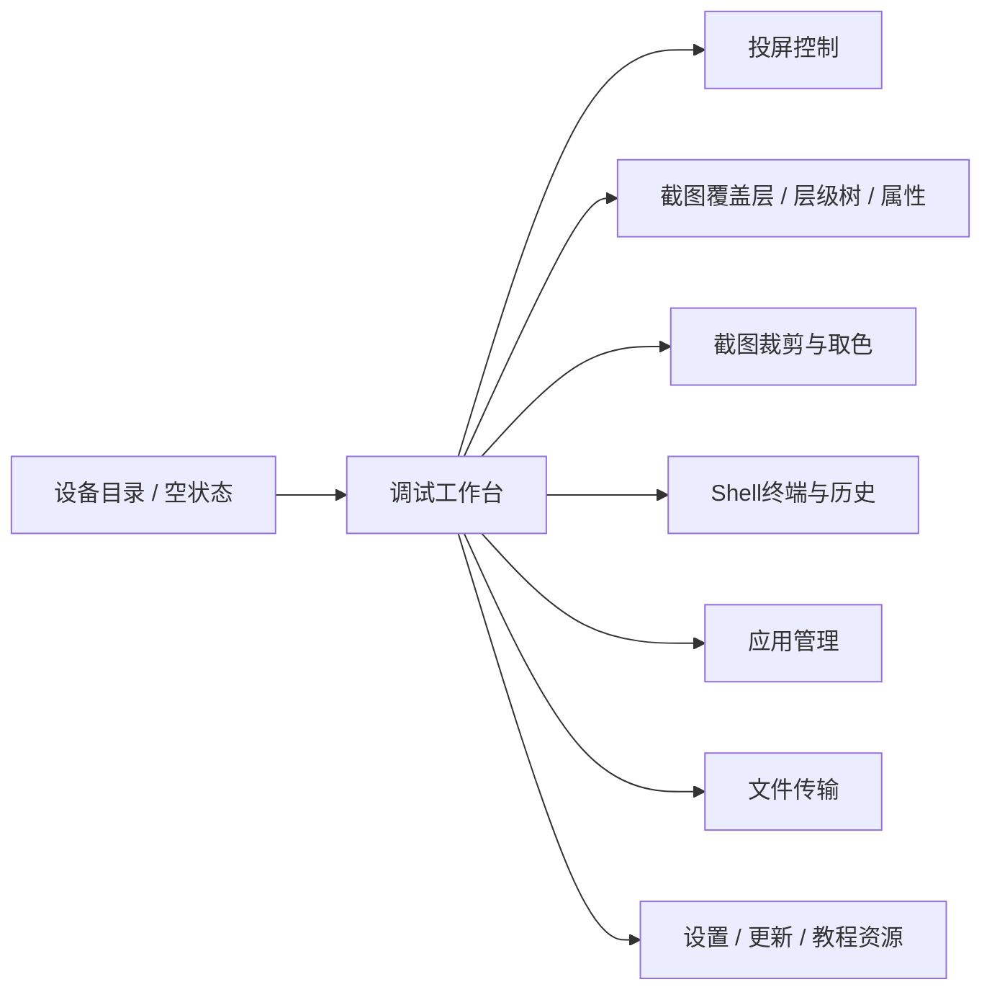

# uispec：双程序界面结构与交互反推

> 开发参考资料，来自 2026-10-14 静态分析；不是已批准的首版建设规格，也不是当前运行结果。原始日志、CIL/IDA 导出、样本和资源中间文件已按用户清理要求移除。正文中的 token/RVA、evidence 路径仅保留为历史定位，不能当作现存文件；动态修正见 [已知问题](../KNOWN_ISSUES.md)，来源与可复核边界见 [来源说明](../SOURCES.md)。

版本0.1，2026-10-14。证据来自View/ViewModel、命令绑定、数据字段与BAML资源目录。没有运行目标渲染界面；本规格能说明页面职责、输入/输出和状态，不能保证像素级布局、主题、字体和截图版本一致。功能入口若仅有资源/类型而未验证导航可达，会注明。

## 1. 通用界面规则

以下为复刻设计约束，并非全部原UI都已验证满足。涉及具体原实现的部分另附证据。

- 始终显示当前设备身份；批量操作同时显示目标集合/数量。设备状态、API状态、投屏状态、脚本状态分别表达。
- 绑定驱动列表与状态更新；后台工作回到WPF Dispatcher更新画面。加载/执行中的控件依CanExecute/忙状态限制重复操作。
- 错误显示操作阶段与可定位的设备信息。图像/列表为空时区分未选择、正在加载、离线和失败。
- 语言从资源绑定获取；LanguageCore缺key时原实现可显示`!!key!!`。确切中文文案未全部恢复时用语义占位，不伪称原文。
- 标准色、字号、控件尺寸、窗体初始位置仍待运行确认；AppConfig存在窗口与墙布局偏好，不等于原截图尺寸。

## 2. API调试工具

### 2.1 信息架构

BAML证据：`view/mainwindow.baml`、`debugview.baml`、`devicelistview.baml`、`devicelistemptystateview.baml`、`screencastview.baml`、`uidumpview.baml`、`uilevelview.baml`、`shellview.baml`、`appmanageview.baml`、`transfermanageview.baml`、`screenshotview.baml`、`colorminiview.baml`。历史完整73项清单原路径为 `evidence/debug-resources/wpf/resources.tsv`（已清理）。发现教程图标资源；入口可达性及远端内容待验证。

### 2.2 页面与组件

| 页面    | 主要字段/组件                                                                       | 操作与反馈                                | 依据                                            |
| ----- | ----------------------------------------------------------------------------- | ------------------------------------ | --------------------------------------------- |
| 设备目录  | 搜索；设备名/型号/品牌/Android版本/分辨率/选择状态；扫描起止IP、端口、发现与连接计数                             | 刷新、重启ADB、扫描、选择启动；扫描中状态、无设备空页         | 类型`0x020000db`；扫描`0x0600017f`；设备表`0x06000169` |
| 投屏    | 图像区；分辨率/FPS/码率的Selected与Applied状态；返回/Home/任务键                                 | 应用参数、单设备输入；非法图像尺寸不能映射坐标；图像载入中与连接失败区分 | 类型`0x0200002e`；`0x060000bd/000cf`             |
| 节点调试  | 截图矩形覆盖层；层级树；text/resourceId/class/description/bounds及状态属性；搜索过滤                | 刷新截图+Dump；选矩形同步树选中；展开折叠；导出结构         | `0x06000484/003d5/003de/005c2`                |
| 截图与取色 | 可缩放/平移图像、裁剪区域、待确认裁剪；设备坐标、HEX/RGB、颜色历史                                         | 选择像素/区域、保存裁剪                         | 类型`0x020000ff/000c6`与对应BAML                   |
| Shell | CurrentInput、执行按钮、时间/序号/命令/输出历史                                               | Trim后执行；忙状态禁重复；结束清输入并复位历史游标          | `0x06000521`                                  |
| 应用管理  | 应用列表、搜索、包名与元信息、设备上下文                                                          | 安装、卸载、清数据；显示结果                       | `0x060007ff/00806`及命令绑定                       |
| 文件传输  | LocalPath/FileName/SizeText/IsApk/AutoInstall/State/Progress；TargetFolder/总进度 | 加入任务、选路径、开始；支持APK自动安装                | `0x0600074a/007b8`、类型`0x020000fd/00104`       |
| 设置/更新 | 投屏整数偏好、语言、版本更新对话框资源                                                           | 保存设置；具体更新URL和完整文案未恢复                 | `0x06000887..88c`、Settings/VersionUpdate BAML |

节点选择与手机动作必须在交互说明中分开：`NodeClickCommand`实际链为取消旧选择→选中新矩形→发送SourceNode消息，不是已确认的手机tap。调试工具没有已确认的通用脚本编辑器/录制器，不应在还原界面中擅自添加这些页并标作原有。

### 2.3 关键状态流

以下逐区反馈为复刻建议；原代码已确认各步骤异常处理与IsLoadUIDump等状态，不足以证明全部提示如何渲染。

设备未选：工作台不发设备命令 → 选择/连接：显示加载 → 投屏/截图/Dump各自完成：逐区更新 → 任一失败：对应区显示失败，保留可用区。刷新Dump受IsLoadUIDump防重入。

文件队列按项显示状态/进度；整体忙状态表示仍在处理，不应把“已上传”与“APK已安装”合成一个未经确认的成功标志。

## 3. 极星云控

### 3.1 信息架构与可达性

静态支持的组成：LoginStartWindow；主壳/可折菜单；设备墙/列表与分组；主控/浮窗；应用与文件弹窗；文本/剪贴板；API服务；脚本；代理/环境/备份。

云控保留新Shell布局与原有弹窗实现。`Shell.Layouts.AppManageLayoutViewModel.DemoFill`存在示例填充，而实际应用操作在`Popups.AppManageViewModel`。设计还原必须区分占位壳与已追踪操作链，不能把全部资源同时视为已可用菜单。

| 页面            | 字段/组件与交互                                                | 状态与限制                              | 证据                                               |
| ------------- | ------------------------------------------------------- | ---------------------------------- | ------------------------------------------------ |
| 启动/登录         | 登录启动窗；应用初始化/设备准入状态                                      | 商业登录细节与服务端规则未完整恢复                  | App.OnStartup、RunDeviceStartupPipelineAsync      |
| 设备墙/列表        | 设备图像/名称/状态；分组；选中集合；墙列数；主控入口；同步鼠标/键盘开关                   | 小屏/主屏各自参数；离线/重连状态；列数配置归一5..20      | ScreenList/DevicesLayout VM；`0x06001433/01434`   |
| 主控与浮窗         | 主设备投屏、输入、目标设备集合                                         | 切换源时防旧输入误投；同步关闭时目标不参与              | Router/Coordinator/MainControlInputHandoffPolicy |
| 应用管理弹窗        | 设备/分组、应用列表、过滤、启动/停止/安装、清数据/卸载                           | 清除和卸载有确认对话框并考虑其他已选设备               | `0x06001a05/01a11..14`                           |
| 文件同步          | 电脑盘符与目录、手机目录、路径面包屑、刷新/返回、双向同步                           | 未选设备/文件有Warning；busy和进度反馈          | `0x06001f7f/01f80/02075`                         |
| 文本/剪贴板        | 文本文件/内容、推送/拉取、JXKeyboard安装                              | 安装、超时和失败反馈；目标设备明确                  | `0x06000f44/01315/01316`                         |
| 普通API面板       | 设备选择、搜索、分组/状态筛选、全选/范围选择、批量启停、运行摘要、网关端口/自动启动             | 每设备地址/端口/状态；未启动不显示为可调用             | ApiServiceLayoutViewModel `0x0600127a..28e`      |
| Automator API | 独立网关/设备会话状态与端口配置                                        | 默认17171；不能展示普通API的ok/data范例作为该网关响应 | AutomatorApiServiceManager `0x0600302f/03043`    |
| 脚本管理          | 导入包的Name/Version/Description/Parameters；选设备、运行/停止、按设备日志 | 同设备查重；断线取消；最多500条日志；原Pause实际Cancel | ScriptPackage/Scheduler/RuntimeLog服务             |
| 代理            | 设备/代理类型/服务器/端口/凭据/状态；启动停止及检查                            | root不满足需失败反馈；凭据字段应遮蔽；不展示未验证的检测通过承诺 | ProxyProfile/ProxyService/Runner                 |
| 环境配置          | 国家/语言/时区/SIM/位置等字段                                      | 模型存在已证；每个系统效果与ROM依赖未确认             | EnvironmentConfigEntity                          |
| 资料备份          | 设备/应用/备份记录/文件/备注/进度；导入导出恢复删除                            | 恢复含清数据；具体确认弹窗呈现尚待运行验证              | AppCkEntity与JXAPPCK接口                            |
| 设置/诊断         | 主小屏参数、硬解、同步、重连、语言、API、布局等                               | 库默认值被宿主/用户配置覆盖；不能只按构造器填写UI默认       | AppConfig 46字段；Load/Save                         |

### 3.2 API信息呈现

普通网关显示host/port与runningCount；设备行显示serial、name、brand、model、Android版本、连接类型、分组、端口和baseURL。动作区域的输入按所选API协议切换：普通swipe为DurationMs，Automator为steps/stepMs；不要混用同一个未标单位的“速度”输入框。

响应区应显示HTTP状态与JSON体，并保持错误message可复制。此响应展示是复刻建议；完整原面板像素与字段排列未恢复。静态端口默认不当作当前监听状态。

### 3.3 脚本信息呈现

包身份和版本在运行前可见；参数以Key/Type/中英文Label/Unit/范围表达。单设备状态至少区分未运行、执行中、取消中/已结束、失败；这些是语义归纳，原枚举值另以源码证据为准。若重建界面，按钮建议明确写“停止”，避免沿用原Pause文案造成可续跑的误解。

日志按serial分开，包含Timestamp和Message；超过500条的历史被淘汰，不承诺永久审计记录。普通异常会被重新抛出，UI需观测任务结果；不能只订阅日志就认定执行成功。

## 4. 界面验收清单（待运行）

1. 在未选/连接中/就绪/离线/失败状态下检查按钮可用性与提示。
2. 用两个不同分辨率设备检查投屏缩放、节点框与点击坐标；单独验证旋转和黑边。
3. 切换主控与目标组时连续按下/拖动/抬起，确认不误投、不残留按下。
4. 导入坏脚本、重复运行、停止、断线，确认状态与实际任务一致。
5. 对卸载、清数据、备份恢复确认窗口核查设备数量与包名；本次不执行破坏性动作。
6. 换语言/窗口尺寸、重启、损坏配置，检查资源fallback与布局恢复。
7. 对20台列表/设备墙验证滚动、选择、主屏切换和日志更新；性能尚无结论。

未还原项：完整原始XAML、所有DataTemplate、精确颜色/间距/字体、所有动态菜单可达性、远程教程/脚本市场页面，以及各许可状态下的控件差异。
