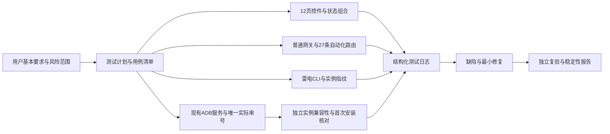
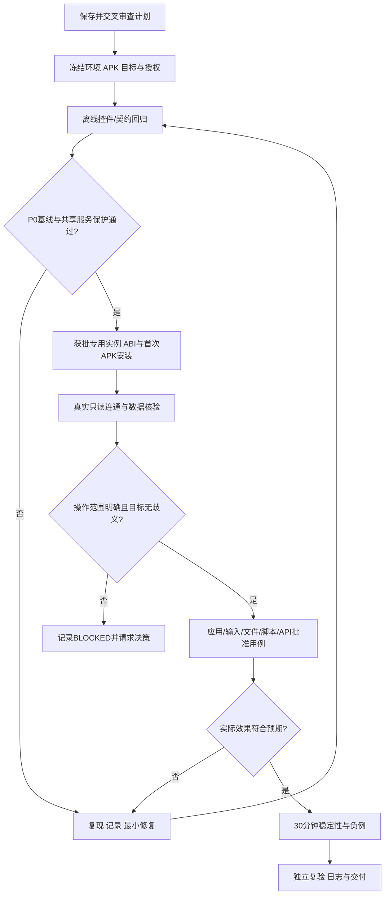

# 当前计划：全面验收与Apple风格体验重设计

日期：2026-10-15。执行目标保持用户本轮全部要求，不缩成只换主题或只测离线。用户明确授权自主推荐和逐功能push，无需再次提问；不创建定时自动化，不扩大敏感数据/权限/支付/基础设施边界。

## 目标、范围与成功标准

完整要求见docs/PRD.md，技术规格见docs/SPEC.md，视觉/命名见docs/UI_SPEC.md，依赖任务见docs/TASKS.md，进展见docs/PROGRESS.md。覆盖原12页的每个控件和正常/异常用户路径、重复职责清理、企业布局、Apple HIG风格、简体中文短名称，以及390/768/1000/1440/1920宽度响应式；保留全部原功能、数据和接口。

必须以当前最终二进制和逐要求证据确认完成。149项、控件清单、Demo、旧实机报告分别只有对应层级的证明力；未实现/未验不当成功，必需项缺失则goal继续。六尺寸包含390×844、390×640、768×1024、1000×700、1440×900、1920×1080，另测字体/DPI。

## 约束、假设与非目标

产品仍是Windows WPF，小屏是逻辑窗口响应式，不新增手机原生客户端。保留原0保护、唯一身份/代次/transport、API所有权和忙状态门禁；不操作真实账号、支付、隐私许可或共享ADB/网络设置。真实测试先冻结专用1/2，使用无账号测试包和临时目录，不卸载或清理用户抖音数据。不做merge/deploy/release、全局安装或自动删除worktree。

用户要求无人值守由当前goal阶段推进实现，不启用额外L3计划任务；推荐方案不等于代替用户接受不明风险。对应动作无法安全执行时如实记录，继续其他任务，不偷偷缩小完成判据。

## 第一性原理与方案

已知事实：固定最小宽1000阻止小屏；固定侧栏/双栏造成压缩；历史实机应用入口已过时；主控与当前目标可能混用。根问题是缺完整路径和状态/布局契约，不只是颜色。推荐小步共享设计系统、逐页响应式和当前控件实测，先修P0目标候选，再改视觉。

| 方案 | 复杂度/风险/验证维护 | 结论 |
|---|---|---|
| 保留WPF、12页和后端，先功能证据与目标修复，再共享主题/逐页适应布局 | 中；需六尺寸/实机/独立复验；迁移和接口风险最低 | 推荐 |
| 只换主题、改MinWidth或整页缩放 | 低；无法证明真实路径，固定栏仍不可用，控件过小 | 拒绝作为本目标交付 |
| 改写Web/跨平台客户端或删除难测功能 | 高；信息结构、接口、权限和维护成本扩大 | 不采用 |

## 架构图

~~~mermaid
flowchart LR
  Goal[完整用户目标] --> PRD[PRD与UI规格]
  PRD --> Tasks[依赖任务与逐控件矩阵]
  Tasks --> UI[共享主题与12页响应式]
  Tasks --> Fix[逐缺陷最小修复]
  UI --> Demo[六尺寸真实控件Demo]
  Fix --> Offline[协议与状态负例]
  Demo --> Live[独立实例真实效果]
  Offline --> Live
  Live --> Verify[非实现者复核]
  Verify --> Git[每功能提交push]
  Git --> Audit[最终逐要求完成审计]
~~~

## 执行流程图

~~~mermaid
flowchart TD
  A[读当前状态与计划] --> B[独立UI和风险审查]
  B --> C[复现单个问题/定义预期]
  C --> D[隔离worktree最小实现]
  D --> E[正式测试与页面/实机验证]
  E --> F{独立verifier通过?}
  F -->|否且少于3轮| C
  F -->|风险/依赖阻塞| R[记录缺口 继续其他安全任务]
  F -->|是| G[README 报告 清单 commit push]
  G --> H{还有用户必需项?}
  H -->|是| C
  H -->|否| I[最终版本完整回归和30分钟稳定性]
  I --> J[逐要求审计 证据足够才完成goal]
~~~

## 任务与依赖

执行采用ai-coding-workflow的PRD→SPEC/UI→TASKS→Phase→验收纪律；真实subagents至少从UI结构和可执行风险两个角度审查，并以非实现者复验。superpowers未可见，使用当前真实工具和该流程fallback，不假称调用。

完整每任务优先级、文件范围、依赖和完成条件在docs/TASKS.md。顺序为A00列表基线/计划→A01全控件矩阵→A02目标P0→A03主题命名→A04公共响应式→A05设备监控/A06检查截屏/A07应用文件/A08终端文本自动化/A09接口工具设置→A10细节→A11最终实机稳定性→A12交付审计。P2视觉细节同属本轮要求，不能跳过。

先验证和保存已完成列表精简；P0候选单独复现/修复/push。互不重叠的页面可并行独立worktree，最终整合顺序和回归由主代理控制，不在同一文件多代理写入。

## 验证、日志和完成门槛

- tools/Build.ps1 -Verify，便携SDK使用现有.tools/dotnet/dotnet.exe。
- Desktop --smoke --data-dir独立绝对路径 --screenshot绝对路径，扩展为六尺寸、12页、模态/菜单和正常/空/忙/取消/目标变化；实际触发控件而非仅清点。
- 当前应用页真实双实例自有包安装/读取/启停/卸载、文件哈希、文本回读、脚本步骤、API实际效果、视频帧及资源清理；不复用会quit/modify实例的旧prepare。
- 最终版本30分钟稳定性与目标证明/共享ADB owner不变。原始日志图像放artifacts/apple-experience，不进源码包。
- docs/codex/apple-experience/TEST_MATRIX.md逐功能/控件记录正常与异常、实际结果、证据与状态；DEFECTS.md保留红/绿和未满足项。全部必需项证据充分、无开放阻断，才调用goal完成。
- 每个修复独立审查后，更新README/报告/源码清单，提交并push到私有zhuy3075-ui/matrix-device-ldplayer的codex/unified-device-access；不强推，不改test备份，排除配置/APK/二进制/原始证据/原有英文截图。

## 失败模式、回退和推翻条件

断言失败保留原轮次，不删检查或拼接成功片段；弹窗/焦点时序须与真实用户顺序一致且有界等待。真实效果、依赖支持和隐私边界不明则停止该动作，不自动开启root/改证书/运行可能抢共享服务的外部ADB。不回滚用户工作；方案需要改变平台、信息结构或高风险环境时记录冲突并重评，不通过缩小目标自称完成。

## 计划审查与产物校验

已调用两个真实只读代理盘点UI和测试风险；结果包括固定宽度、过时应用实机入口、不可误删的独立工作流和主控投屏目标P0候选。保存后再次独立审PRD/SPEC/TASKS及执行性。校验文件存在、两段Mermaid、P0/P1/P2、所有任务依赖/验证、无占位词和git diff --check。

---

## 历史计划（原文保留，不作为本轮最新验收范围）

# 矩阵设备全功能实测与稳定性验收计划

日期：2026-10-14。状态：计划与安全门槛阶段；本轮真实模拟器测试尚未开始。先保存计划、独立审查，再按阶段测试、记日志、修复和复验。

## 目标与成功标准

交付可重复启动、连接目标雷电实例、完成已批准基本操作且失败可定位的桌面程序。用户已确认本轮基本要求：稳定连接雷电、截图/节点调试、点击滑动与文字输入、应用启停、文件传输、脚本、本机API、简体中文界面。

- 已批准P0用例全部实机通过，没有开放的P0/P1缺陷；每项都有实际效果证据，不以命令受理替代完成。
- 12个功能页建立完整控件清单，覆盖可用、忙、空、离线、坏输入和取消状态；跨页与筛选不会改变未指定的目标。
- 真实单实例30分钟稳定性测试：无程序崩溃、无串台、无新建/重启共享ADB服务；至少200次有界只读查询、30次截图、10次节点读取。失败重试和恢复记录独立统计，不能把重试成功抹成首次成功。
- 命令均设置超时；一次超时不得堵死后续命令；脚本取消后2秒内不得执行新步骤。具体实机延迟、成功率和资源变化原样记录，不预设硬件性能成绩。
- 所有失败/阻塞/未实现项、修复记录和剩余风险保存；被风险门槛挡住的项目不计通过。

## 背景、范围与约束

| 项目 | 已知事实或处理 |
|---|---|
| 项目 | MatrixDevice.Reconstructed，WPF + .NET10，六项目；已有54项离线测试和demo界面验收 |
| 需求依据 | docs/reference/PRD.md、API.md、uispec.md及COVERAGE/ASSUMPTIONS；原PRD注明静态反推，不是已批准全部实测承诺 |
| 测试输入 | C:\Users\Administrator\Downloads\aweme_43633312a_v5072_400701_a304_1791543193.apk；已安装应用和文件内容仍须核对，不能从文件名推断包名/版本 |
| 设备 | 用户确认已运行模拟器。上一轮仅雷电14实例0；ADB两条串号可能是同实例别名，本轮重新核对，不能当两台 |
| 共享服务 | 上轮5037由极星ADB持有；本轮记录实际owner/PID/path/协议版本，禁止kill-server/start-server/自动connect/disconnect/权限与环境变量迁移 |
| 授权 | 用户允许使用独立实例全面测试。新建空白实例或指定已有独立编号仍待回答；在此之前不创建、复制、安装或操作现有实例。独立实例内基本范围获批后执行；root、账号、代理/恢复等不因“全面测试”自动获批 |
| 账号与隐私 | 不登录、不读取凭据、不点赞关注、发布消息/内容、不支付、不操作账户设置；不把真实截图/节点全文加入公开源码包 |
| 数据隔离 | 桌面验收独立配置目录；设备只在批准后使用 /sdcard/MatrixAcceptance/随机runId，清理只删本次生成文件且核验路径 |
| 能力 | 使用当前可见工具与已安装运行时；不安装不可见插件。保持现有CODEBRAIN不读不写 |

非目标：替代抖音业务测试、绕过应用风控、改模拟器设备身份、复制商业授权、保证未知ROM或私有agent能力、以一实例或别名验证20台容量。

## 第一性原理

已知事实：构建、demo、HTTP契约通过不能证明真实Android效果；当前UI/CLI/ADB/agent的支持范围不同。

硬约束：保留用户账号与设备数据、共享ADB不被替换、操作只投递到核对过的实例，日志不泄露私密数据。

根问题：缺少从控件或API请求到目标设备实际结果的完整证据链。最小解法是一个真实实例、冻结环境与APK、确定目标、逐项请求与效果核验，然后测试状态组合和稳定性。

仅补界面颜色或增加“命令成功”提示不足以解决根问题。失败模式包括别名重复投递、旧代次、UI过滤改变当前设备、焦点错误、ADB客户端抢服务、脚本取消竞态和未实现功能虚报成功。

## 方案比较

| 方案 | 复杂度/成本 | 风险/维护 | 结论 |
|---|---|---|---|
| 分层用例、独立日志、单实例真实证据、最多3轮修复复验 | 中；每个缺陷先复现再回归 | 可定位、边界明确，重用现有代码与测试 | 推荐 |
| 只做连通与只读截图冒烟 | 低；数分钟 | 只能证明连接与图像，不能证明全功能稳定 | 用户缩小范围时采用 |
| 直接在个人账号里批量点击并把HTTP200当完成 | 表面低，后续定位高 | 账号/数据副作用、不知道真实目标和完成效果 | 拒绝 |
| 重写底层或混用未知JAR/DLL来填满功能表 | 高 | 协议和迁移风险超范围，缺验证基线 | 拒绝 |

## 架构图

## 执行流程图

## 阶段任务

按ai-coding-workflow执行阶段验收，优先使用superpowers / subagents交叉验证；当前superpowers未可见，采用实际多 agent审查与现有测试工具作为fallback，不声称调用了未安装能力。每阶段完成后记录状态、证据、下一步与风险。

| ID/优先级 | 依赖 | 执行内容与涉及文件 | 验证与完成标志 | 失败处理 |
|---|---|---|---|---|
| T00/P0 | 无 | plan.md、docs/testing/*：范围、安全门槛、控件/功能用例与日志格式；两类独立审查 | 计划无占位，案例可执行，危险项明确分开 | 先修计划，不操作设备 |
| T01/P0 | T00 | 主机静态环境与APK清单：SHA256、manifest包名/版本/ABI/签名可得性、ADB owner；仅smart socket host查询与雷电list2 | APK来源/静态属性与服务身份有证据；不调用guest安装信息查询 | 不从文件名推断版本，不启动native ADB |
| T02/P0 | T00 | Desktop/测试：全控件清单、两尺寸/三视图、空/忙/取消/选择/导航/输入保持 | P1-UI-001未复现，保留三视图过滤回归；已复现节点与忙操作缺陷修复 | 只改相关Desktop文件，独立复验 |
| T03/P0 | T01,T02 | Core/ADB runner及测试：现有服务保护、固定host/port、避免继承错误环境；授权串号allowlist过滤发现与所有操作；客户端超时只结束自身 | 不读取非授权guest；缺服务/不兼容先拒绝；执行前后owner/protocol不变 | preflight不是原子保证；无可靠保护就只用smart socket或停止真实命令 |
| T03A/P0 | T03,独立实例选择确认 | 创建获批空白实例或核对用户指定独立实例；记录index/PID/唯一serial；ABI/native bridge核验后首次安装给定APK，读取实际包版本并安全启动 | 不复制原账号/数据；安装日志、包版本、启动与前台效果可核对；测试实例保留，不自动删除 | 兼容性/许可/权限页面不明即BLOCKED；已有同包不自动覆盖/降级 |
| T04/P0 | T03A | 只访问测试guest：设备属性、截图PNG/取色/裁剪、节点树/选择/导出、固定只读Shell、应用列表、本机查询API | 响应对应唯一serial；APK/已安装包版本对照；截图/树各记时间，节点缺失不伪造 | dump会写本程序临时XML，清理只删自己的GUID文件；原始输出私存 |
| T05/P0 | T04 | 测试应用启停、Home/Back、确认安全页面的点/滑；批准输入框文本，不提交业务动作 | 活动窗口/包/PID/节点或前后截图证实效果；两代次/焦点一致 | 焦点/页面/权限不明停止，记录BLOCKED |
| T06/P1 | T05,临时文件范围 | 临时文件push/pull与哈希；合法/坏脚本导入、启动/重复/取消、读取参数与步骤日志 | 双向SHA256一致，取消后无新步骤，重复执行一次，错误可见 | 不碰用户原文件；失败后核验临时范围再清理 |
| T07/P0 | T04-T06 | 普通网关/逐设备端口/27路由/雷电8写动作逐项登记；同一动作经UI与API核对一致性 | 请求、结构、错误码、真实效果分别记录；未知/不可用功能不计业务PASS | 无副作用验证权限时只测拒绝路径并将功能BLOCKED |
| T08/P1 | 所有核心P0 | 30分钟只读稳定性；按批准范围追加安全操作、脚本取消、关闭程序资源清理 | 保存每次耗时/错误/owner与资源采样；无崩溃/误投、无新服务、超时后能继续 | 中途失败先停长测定位；修复后重新完整计时 |
| T09/P2 | 专用实例+具体操作风险接受 | 覆盖/卸载/清数据/实例退出重启、scrcpy、root/时区/恢复；真实双实例和容量；首次安装不放此阶段 | 每项单独目标、前置快照与恢复策略；否则BLOCKED | 不对当前账号实例替代授权，不自动扩大范围 |
| T10/P0 | 实际已完成阶段 | 独立复验；docs/testing结果/缺陷/变更、构建与使用说明、完整源码包 | 开放P0/P1为0且核心实机通过才标基本范围交付；其余明确列出 | 同一问题最多3轮修复复验，仍失败升级用户，不伪造完成 |

## 用例与结果判定

详细案例见docs/testing/TEST_CASES.md，控件清单由当前源码和真实渲染产生，不按原产品控件数量猜测。

- PASS-OFFLINE：算法、模拟、文件系统、协议或UI demo测试通过，仅覆盖对应离线行为。
- PASS-LIVE：指定真实实例的实际结果满足该用例，有效果证据；请求返回0/200单独不足。
- FAIL：已执行但实际不符、异常、误目标、无效日志或不可恢复。
- BLOCKED：缺授权、专用实例、第二设备、可信客户端/agent/scrcpy或无法确认目标；不计通过。
- NOT-IMPLEMENTED：当前实现没有对应能力；错误拒绝路径可以PASS-OFFLINE，但业务功能仍未满足。
- N/A：用户明确排除或最新需求替代的项，例如固定简体中文替代原英文切换；不得拿N/A隐藏失败。

## 日志与隐私

每次运行生成artifacts/acceptance/runId。结构化JSONL逐条包含caseId、时间、阶段、build源码摘要、targetIndex/canonicalSerial、generation、授权类别、操作概要、预期、实际、status、durationMs、errorCode、artifact哈希、defectId、round、清理结果。应用文本/用户名/密码/token/完整个人路径不直接写入公开报告。

request/response/截图/节点原始证据按需保存在该私有目录，默认不进入源码ZIP；公开docs/testing仅摘要与证据ID/哈希。缺陷记录复现步骤、预期/实际、根因、修改文件、修复前后测试、独立结论和残余风险。正常动作、失败及恢复都留日志，不只写最后成功。

## 验证命令与验收门槛

离线命令：tools/Build.ps1 -Verify；桌面DLL --smoke --screenshot绝对路径，两尺寸分别1440×900和1000×700。真实命令在T01/T03冻结目标后由验收runner执行并逐条记录。原构造按AdbPath发现已移除；当前只在有显式授权串号时发现guest，计划阶段仍不得配置真实授权。

计划检查：Test-Path plan.md；rg逐项检查目标/范围/安全/架构图/流程图/P0/P1/P2/ai-coding-workflow/superpowers/fallback/验收标准/日志；Mermaid两段有完整节点；项目当前无Git仓库，git diff --check改用允许目录文件摘要与构建/格式检查，不能声称Git检查已执行。

UI错误退出补测：仅demo使用无效截图路径，必须非零退出且不残留窗口，不能把GUI错误清理测试用于退出真实模拟器。

## 已知缺陷与推翻条件

P1-UI-001：在当前WPF版本三视图过滤/空筛选未复现选中设备误变，记录为未复现观察，保留回归，不据此改选择模型。

P0-ADB-001：已移除native ADB执行，改用现有服务socket、串号授权、正transport-id和固定服务进程代次保护。62/62离线回归通过，仍须真实实例验收。[AOSP原始实现](https://android.googlesource.com/platform/packages/modules/adb/%2B/refs/heads/android15-qpr2-s8-release/client/adb_client.cpp)说明原native路径为何不足。

2026-10-14授权补记：用户允许新建不复制数据的专用实例、安装所给APK，并按基本范围验收；用户已自行关闭极星。当前5037无服务，允许雷电正常启动流程注册服务，本程序不主动start/kill ADB。测试实例保留，index由创建前后清单差集取得。

以下情况停止原方案并调整：用户缩小/扩大基本要求；APK与已安装包不同且未批准替换；串号/实例无法唯一关联；无法保证共享服务保护；核心依赖私有agent/ROM；真实节点树或输入接口不支持目标应用；稳定性失败超过3轮。此时报告证据、可用子集和替代路径，而非继续堆接口。

## 审查记录

已读取ai-coding-workflow、write-codex-plan和loop-verifier；三个实际子代理分别审控件覆盖、环境/ADB风险、证据与验收标准。审查要求已写入：区分离线/实机、唯一实例与别名、禁止计划阶段隐式ADB发现、明确危险功能门槛。最终独立审查结论在docs/testing/TEST_LOG.md补记，不提前宣称通过。

## 最终阶段状态

T01-T08/T10本轮基本范围已执行：68/68离线、两尺寸独立demo、唯一实例实机输入/APP/文件/脚本/分项API及GUI8组；完整只读长测1801518ms、222/30/10、272条0失败。T07按20业务/请求+6拒绝+1诊断登记而非全部业务通过；T09危险/多实例/实时视频保持未验。最终结论与版本边界见docs/testing/REPORT.md，原始失败/修复/复验保留；不读取或删除旧CODEBRAIN。
